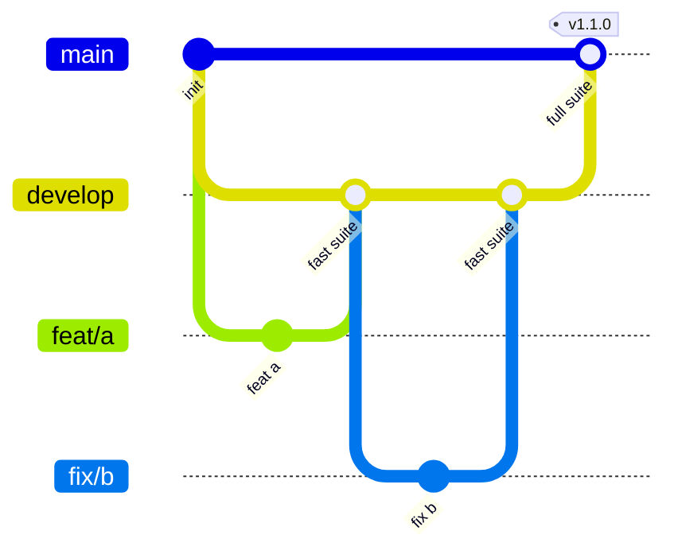

<!--
SPDX-FileCopyrightText: 2026 The Vellum contributors
SPDX-License-Identifier: AGPL-3.0-only
-->

# Contributing to Vellum

## Branches



| Branch | Purpose | Merges in from | Gate |
| --- | --- | --- | --- |
| `develop` | Integration branch; all work starts here | short-lived feature branches | **Fast suite** |
| `main` | Always releasable; releases are tagged here | `develop` only, at regular intervals | **Full suite** |
| `<type>/<topic>` | One change each | branched from `develop` | — |

1. Branch from `develop` with a name of the form `<type>/<topic>`, where
   type is a Conventional Commits type and topic says what changes, in
   kebab case: `feat/typed-ids`, `fix/watcher-rename`, `docs/adr-0002`.
   CI rejects other names (Dependabot's `dependabot/…` excepted). Open the
   pull request against `develop`.
2. At regular intervals a maintainer opens a pull request from `develop`
   into `main`. It merges with a merge commit, never a squash, so history
   stays shared.
3. Releases are cut by tagging `main` (`vX.Y.Z`, semver).
4. An urgent fix branches from `main`, merges into `main` through the full
   suite, then `main` merges back into `develop`.

## Checks

| Suite | Runs on | Contents |
| --- | --- | --- |
| Fast (`ci.yml`) | every pull request into `develop` or `main`, pushes to `develop` | rustfmt, clippy, rustdoc, unit and property tests (nextest), crate boundaries, cargo-deny, cargo-audit; Prettier, tsc, ESLint, knip, Vitest with 85 % coverage, pnpm audit; REUSE, yamllint, shellcheck, markdownlint, Vale, local links, gitleaks, infrastructure linters; Conventional Commits, DCO, branch name and description template |
| Full (`full.yml`) | every pull request into `main`, pushes to `main`, nightly | the fast suite, plus Rust line coverage of at least 85 %, the release build, Playwright end-to-end with axe accessibility checks, and external link checks |

Further layers join the full suite as their code lands: golden corpus,
integration with testcontainers, contract, performance, chaos, security
scans and the upgrade and restore drill.

Run the same checks locally before pushing:

```sh
cargo fmt --all --check
cargo clippy --workspace --all-targets -- -D warnings
cargo nextest run --workspace
cargo xtask boundaries
cargo deny check
pnpm --dir web run format:check
pnpm --dir web run lint
pnpm --dir web run test
```

Enable the repository hooks once: `git config core.hooksPath .githooks`.

## Commits and pull requests

CI enforces every rule in this section on each pull request.

- **Commit template**: run `git config commit.template .gitmessage` once.
  Each commit has a Conventional Commits subject, `type(scope): summary`
  of at most 72 characters, where type is one of
  `build chore ci docs feat fix perf refactor revert style test`; then a
  blank line; then a body saying why. The `.githooks/commit-msg` hook
  checks the same rules locally.
- **Pull request title**: a Conventional Commits subject, because it
  becomes the squash commit on `develop`.
- **Pull request description**: the template in
  `.github/pull_request_template.md`. Summary, Requirements, Changes,
  Tests, Observability and Security must each be filled in; write "None"
  with a reason when one does not apply.
- **Developer Certificate of Origin**: sign off every commit with
  `git commit -s`. The sign-off must match the commit author.
- **Signed commits** (planned): sign with GPG, SSH or S/MIME so GitHub
  marks them verified. Branch protection will require this once every
  contributor, including automated ones, has a signing key set up.
- **Scope**: one pull request per feature, complete with its tests and
  docs, not one per commit or step. There is no line limit; keep commits
  inside the pull request small and logical so the history reads well.

## Labels

Labels are code: `.github/labels.yml` defines them and the Sync labels
workflow applies changes when that file lands on `develop`.

| Group | Labels | Set by |
| --- | --- | --- |
| `type/*` | `feat fix docs refactor perf test build ci chore style revert` | the pull request title |
| `area/*` | `kernel contracts format store crypto db render export authz collab collections pages work my-work api jobs mcp cli editor web ci docs deploy` | changed paths (`.github/labeler.yml`), or by hand |
| `phase/*` | `foundation format editor drive-books collections work mywork-mcp clients-release` | by hand, following the build order |
| `status/*` | `in-progress blocked ready-to-merge` | by hand |
| `priority/p0` | every requirement is P0 | by hand |
| `size/*` | `xs s m l xl` (under 50, 200, 500, 1,000 lines, or more) | changed lines, generated files excluded |
| `release` | a `develop` → `main` pull request | automatically |

The **Labels** check fails a pull request without at least one `type/*`
and one `area/*` label. Branch protection requires it next to the suite
check. When a new crate lands, add its path to `.github/labeler.yml`.

## Definition of done

Formatted; zero lint warnings; tests at the right layer; tracing spans and
metrics for any new I/O; public items documented; user guide updated if the
change is visible; an ADR in `docs/adr/` if a decision was made; reviewed
by someone who did not write it; CI green.

## Branch protection

Set these under **Settings → Rules → Rulesets** on GitHub.

| Setting | `develop` | `main` |
| --- | --- | --- |
| Require a pull request (0 approvals while there is one maintainer) | yes | yes |
| Required status checks | `Fast suite` | `Full suite` |
| Require branches to be up to date | yes | yes |
| Require signed commits | planned | planned |
| Require linear history | yes (squash merge) | no (merge commits from `develop`) |
| Block force pushes and deletion | yes | yes |
| Restrict who can push | — | maintainers only, and only from `develop` or a hotfix |
