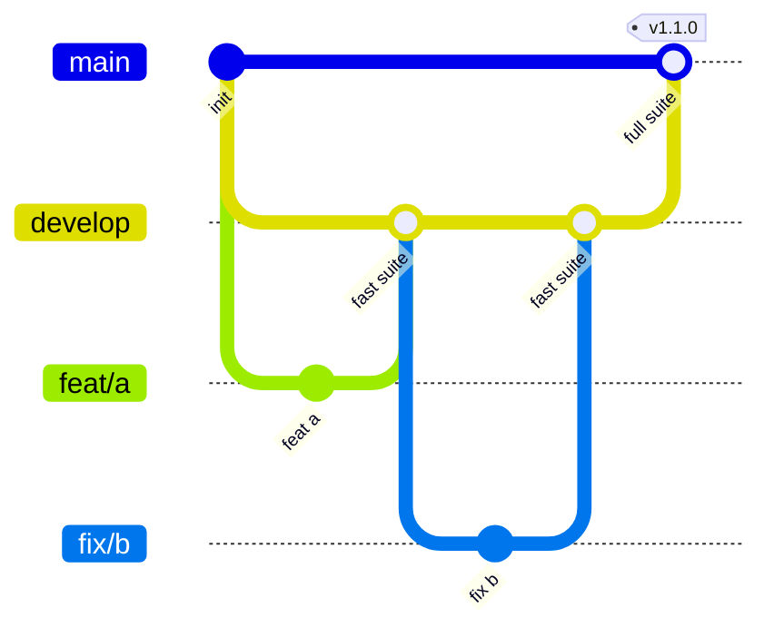

<!--
SPDX-FileCopyrightText: 2026 The Vellum contributors
SPDX-License-Identifier: AGPL-3.0-only
-->

# Contributing to Vellum

## Branches



| Branch | Purpose | Merges in from | Gate |
| --- | --- | --- | --- |
| `develop` | Integration branch; all work starts here | short-lived feature branches | **Fast suite** |
| `main` | Always releasable; releases are tagged here | `develop` only, at regular intervals | **Full suite** |
| `<type>/<topic>` | One change each | branched from `develop` | — |

1. Branch from `develop` with a name of the form `<type>/<topic>`, where
   type is a Conventional Commits type and topic says what changes, in
   kebab case: `feat/typed-ids`, `fix/watcher-rename`, `docs/adr-0002`.
   CI rejects other names (Dependabot's `dependabot/…` excepted). Open the
   pull request against `develop`.
2. Merge with auto-merge: `gh pr merge --auto --squash`, or **Enable
   auto-merge** on GitHub. The pull request squash-merges itself once
   **Fast suite** is green. Pull requests are not re-tested on top of each
   other, so the fast suite also runs on every push to `develop`. When
   it fails there, the **Repo: develop is red alarm** workflow opens a
   "develop is red" issue. Whoever merged the breaking change fixes or
   reverts it, others hold their merges, and the issue closes itself
   when `develop` is green again. If `Cargo.lock` or `web/pnpm-lock.yaml`
   conflicts, merge `develop` into your branch and run
   `cargo xtask relock`.
3. At regular intervals a maintainer cuts a release branch,
   `chore/release-YYYY-MM-DD`, from a green `develop` commit and opens a
   pull request from it into `main`. A frozen snapshot lets the full
   suite finish while `develop` keeps moving. It merges with a merge
   commit, never a squash, so history stays shared.
4. Releases are cut by tagging `main` (`vX.Y.Z`, semver).
5. An urgent fix branches from `main`, merges into `main` through the full
   suite, then `main` merges back into `develop`.

## Checks

| Suite | Runs on | Contents |
| --- | --- | --- |
| Fast (`ci.yml`) | every pull request into `develop`, pushes to `develop` (only the areas the push changed) | rustfmt, clippy, rustdoc, unit and property tests (nextest), crate boundaries, cargo-deny, cargo-audit; Prettier, tsc, ESLint, knip, Vitest with 85 % coverage, pnpm audit; the UI layout suite in Chromium at phone and laptop size; REUSE, yamllint, shellcheck, markdownlint, Vale, local links, gitleaks, infrastructure linters; Conventional Commits, DCO, branch name and description template; linked issue and decision record |
| Full (`full.yml`) | release pull requests into `main` only | the fast suite, plus Rust line coverage of at least 85 %, the reproducible release build and image within their budgets, Playwright end-to-end and the full UI suite (Chromium, Firefox and WebKit at four sizes, with visual baselines), and external link checks |

CodeQL (`codeql.yml`) scans release pull requests, pushes to `main` and
`develop` weekly. The nightly load test, security scan and fuzz runs skip a
night when `develop` has not changed since the last green night.

On a pull request into `develop`, a new push cancels that pull request's
older **Fast suite** and **Labels** runs, so a batch has one live run;
a title or description edit waits for the running one instead. Nothing
else cancels: pushes to `develop` and `main`, release pull requests into
`main`, the nightly and releases always finish. Each test runs once
per event. Inside the full suite, the Rust tests run
only in the coverage job and the UI tests only in the browser matrix, not
again in its copy of the fast suite. A release pull request must come
from a `chore/release-…` branch: one opened straight from `develop` fails
the **Release source** check, because every merge into `develop` would
restart the whole suite.

Further layers join the full suite as their code lands: golden corpus,
integration with testcontainers, contract, performance, chaos, security
scans and the upgrade and restore drill.

Run the fast suite locally before pushing. Install the hooks once, after
cloning:

```sh
cargo xtask install-hooks
```

This turns on the commit template and three git hooks: `commit-msg`
checks the commit message, `pre-commit` checks the staged files in
seconds (format, lint, types, line length and secrets), and `pre-push`
runs `cargo xtask fast`, which mirrors every **Fast suite** check in CI
and refuses the push if one fails. Run it by hand at any time:

```sh
cargo xtask fast
```

Lines stop at 80 characters in every file
([ADR 0074](docs/adr/0074-line-length-80.md)). rustfmt and Prettier wrap
code; split long strings and comments yourself.
`scripts/ci/check-line-length.sh` lists what is still too long, and
`cargo xtask install-hooks` sets `git blame` to skip the commit that
reformatted the repo.

A check whose tool is not installed fails the run, because a skipped check
used to let failures reach CI unnoticed. Install every tool, at the
versions CI uses, with:

```sh
scripts/dev/install-tools.sh
```

Cloud sessions get them from the environment's setup script, which runs `curl -sSfL
https://raw.githubusercontent.com/cruisinme30/vellum/develop/scripts/dev/install-tools.sh |
bash`. Set `VELLUM_ALLOW_MISSING_TOOLS=1` to skip a missing tool instead. The
local run is focused: clippy, rustdoc and the Rust tests cover only the crates
your branch changed, and the web and desktop unit tests only the files related
to your changes, without the coverage gate. The batch pull request into develop
runs the entire suite in CI, so don't run it in a feature branch;
`VELLUM_FAST_ALL_TESTS=1` does it locally if you need to. Tests that need Docker
are left out without a Docker daemon, and CI runs them. Local builds skip debug
info and incremental caches (`CARGO_PROFILE_DEV_DEBUG=0`, `CARGO_INCREMENTAL=0`)
so a test build fits a small disk; set either variable yourself to override. In
an emergency, `git push --no-verify` skips the hook, but CI still gates the
merge.

Before opening a pull request, or after editing its title or description,
check them the way CI will:

```sh
cargo xtask pr-check --title "feat(db): keep jobs once per cluster" --body-file pr.md
```

It checks the branch name, the title (a Conventional Commit, at most 72
characters after the type), every section of the description template, and
that "Closes #N" names an issue, with a decision record for features
([ADR 0048](docs/adr/0048-catch-ci-failures-before-pushing.md)).

### The local gate

Before pushing to `develop`, `main` or a `chore/release-…` branch, run the
local gate on the commit you will push
([ADR 0073](docs/adr/0073-local-ci-gate.md)):

```sh
scripts/dev/gate.sh             # for develop
scripts/dev/gate.sh --release   # for main and release branches
```

It needs only Docker. It runs, in Linux containers, every check CI runs
on that commit: the whole Fast suite with every test, the website, and the
full UI suite in Chromium, Firefox and WebKit; `--release` adds the rest
of the release checks: Rust coverage, two byte-identical amd64 release
builds with their budgets, ClamAV, external links, the nightly results and
CodeQL (`VELLUM_CODEQL` points at the CLI). It tests the commit, not
uncommitted edits, prints a pass or fail table with each stage's log and
a list of what it could not check, and on success stamps the commit's tree. The
`pre-push` hook refuses a push to those branches without the stamp and
prints the command to run; rewording a commit keeps the stamp, any other
change needs a new run. A rerun reuses every stage that already passed on
the same inputs and marks it `cached` (D319), so after a fix only the
stages the fix touched run again; `--fresh` reruns them all. CI always
runs everything. Pushes to other branches run the focused Fast
suite as before, in the gate's container when cargo is not installed.
Then push with:

```sh
scripts/dev/push.sh develop          # or another branch; [<commit>] defaults to HEAD
```

It refuses without the stamp (a `--release` stamp for `main` and
`chore/release-…`), and for `develop` while a **Fast suite** run is in
progress there, unless you pass `--supersede`. A release branch is
replaced with `--force-with-lease` against its current commit on GitHub.
Claude sessions may push only this way. On
a Mac without cargo, turn the hooks on with
`git config core.hooksPath .githooks`.

### Tests that need containers

A test that starts a container through testcontainers is named after the
engine it starts: its name contains `postgres` or `meilisearch`, for
example `postgres_round_trips_a_page`. Without Docker, `cargo xtask fast`
leaves out every test with one of those words in its name, so a new
container test needs no list change. A test that starts a different
engine adds that engine's name to `DOCKER_TESTS` in `xtask/src/fast.rs`.

### UI quality suite

`web/e2e/ui/` opens every app view and every website and help book page in
each display mode (themes, zoom, 200 % text, right-to-left, long text) and
fails on overlapping or clipped elements, sideways scrolling, missing
images or fonts, console errors, layout shift, invisible keyboard focus,
blank loading states and axe WCAG 2.2 AA violations
([ADR 0031](docs/adr/0031-ui-quality-suite.md)). Add a new view's route to
`web/e2e/ui/targets.ts`. Run it locally with:

```sh
scripts/ci/build-site.sh _site
cd web && UI_SITE_DIR=../_site pnpm exec playwright test e2e/ui
```

`UI_BROWSERS`, `UI_VIEWPORTS` and `UI_SCOPE` widen or narrow the run.
`UI_SCOPE=full` (the release check) adds every help page in the default mode;
`UI_SCOPE=exhaustive` checks every help page in every mode. Visual baselines are
refreshed with `scripts/ci/ui-baselines.sh`.

## Workflows

Each workflow name starts with a word that says when it runs, so related
ones sit together in the Actions tab. The required checks are job names
(`Fast suite`, `Labels`, `Full suite`, CodeQL) and do not change when a
workflow is renamed.

| Workflow | File | Runs on |
| --- | --- | --- |
| Checks: fast suite | `ci.yml` | pull requests into `develop`, pushes to `develop` |
| Checks: full suite (release PRs) | `full.yml` | release pull requests into `main` |
| Checks: labels and tracker | `pr-housekeeping.yml` | pull requests opened, pushed to or retitled; descriptions edited; closed |
| PR: auto-merge Dependabot patches | `dependabot-auto-merge.yml` | Dependabot pull requests |
| Security: CodeQL | `codeql.yml` | release pull requests, pushes to `main`, weekly |
| Security: weekly Scorecard | `scorecard.yml` | weekly |
| Scheduled: nightly load, security and fuzz, chaos on Sundays | `nightly.yml` | nightly; skips when `develop` is unchanged |
| Release: server, desktop and drill | `release.yml` | version tags |
| Repo: sync labels and project board | `repo-sync.yml` | label file changes; the project board every 15 minutes |
| Repo: develop is red alarm | `develop-health.yml` | after the fast suite runs on `develop` |
| Website: build and deploy | `site.yml` | website changes, pushes to `main` |

## Issues and decision records

Every change is traceable to the discussion that led to it.

- **One issue per feature or fix.** Open a GitHub issue before starting.
  Keep the discussion there: the problem, the options, the questions and
  the answers, so the issue is the feature's full history.
- **The pull request links it.** Put `Closes #N` (or `Refs #N` when the
  issue stays open) in the **Issue** section of the description.
- **A feature records its decisions.** Run `cargo xtask adr new <slug> --decisions
  N --issue N`. It writes `docs/adr/NNNN-<slug>.md` from
  `docs/adr/0000-template.md` with the next free record and decision numbers
  across all branches (`cargo xtask adr next` only prints them), skipping those
  reserved in `docs/adr/reserved.toml`. Push the branch right away to claim the
  numbers, then fill it in. Every record has the same four sections, **Context**, **Decisions**, **Alternatives**
  and **Consequences**, plus the issue and pull requests in its facts block.
  Keep it short: under 150 lines and at most six bullets in a row; the **Decision
  records** check enforces both, and fails when two records share a number. When
  a feature only extends an existing decision, update that record or name it as
  `ADR NNNN` in the description.

The **Issue and decision record** check in the fast suite enforces this.
Release pull requests, Dependabot, and `chore` or `ci` pull requests are
exempt.

## Commits and pull requests

CI enforces every rule in this section on each pull request.

- **Commit template**: `cargo xtask install-hooks` sets it up. Each
  commit has a Conventional Commits subject, `type(scope): summary` of at
  most 72 characters, where type is one of
  `build chore ci docs feat fix perf refactor revert style test`; then a
  blank line; then a body saying why. The `.githooks/commit-msg` hook
  checks the same rules locally.
- **Pull request title**: a Conventional Commits subject, because it
  becomes the squash commit on `develop`.
- **Pull request description**: the template in
  `.github/pull_request_template.md`, written so a reader with no project
  context can follow it. **Why** (the problem and who it affects, in
  plain words), **What changed**, **How to verify**, and **Security and
  operations** must each be filled in; write "None" with a reason when
  one does not apply. Never name a decision or record bare: "D67" or
  "ADR 0013" goes with a few words saying what it decided and a link,
  for example "chapters use lowercase file names
  ([D67 in ADR 0013](docs/adr/0013-books.md))". CI checks both.
- **Developer Certificate of Origin**: sign off every commit with
  `git commit -s`. The sign-off must match the commit author.
- **Signed commits** (planned): sign with GPG, SSH or S/MIME so GitHub
  marks them verified. Branch protection will require this once every
  contributor, including automated ones, has a signing key set up.
- **Scope**: one pull request per feature, complete with its tests and
  docs, not one per commit or step. There is no line limit; keep commits
  inside the pull request small and logical so the history reads well.

## Labels

Labels are code: `.github/labels.yml` defines them and the Sync labels
workflow (**Repo: sync labels and project board**) applies changes when
that file lands on `develop`.

| Group | Labels | Set by |
| --- | --- | --- |
| `type/*` | `feat fix docs refactor perf test build ci chore style revert` | the pull request title |
| `area/*` | `kernel contracts format store crypto db render export authz collab collections pages work notify my-work api jobs mcp cli sync desktop editor web ci docs deploy` | changed paths (`.github/labeler.yml`), or by hand |
| `phase/*` | `foundation format editor drive-books collections work mywork-mcp clients-release` | by hand, following the build order |
| `status/*` | `in-progress blocked ready-to-merge` | by hand |
| `priority/p0` | every requirement is P0 | by hand |
| `size/*` | `xs s m l xl` (under 50, 200, 500, 1,000 lines, or more) | changed lines, generated files excluded |
| `release` | a `develop` → `main` pull request | automatically |

The **Labels** check fails a pull request without at least one `type/*`
and one `area/*` label. Branch protection requires it next to the suite
check. When a new crate lands, add its path to `.github/labeler.yml`.
Adding a label by hand does not re-run the check; push a commit or edit
the title to run it again, or re-run the failed job from the Actions tab.

## Definition of done

Formatted; zero lint warnings; tests at the right layer; tracing spans and
metrics for any new I/O; public items documented; user guide updated if the
change is visible; a linked issue, and for a feature an ADR in
`docs/adr/` that links it; reviewed
by someone who did not write it; CI green.

## Branch protection

Set these under **Settings → Rules → Rulesets** on GitHub.

| Setting | `develop` | `main` |
| --- | --- | --- |
| Require a pull request (0 approvals while there is one maintainer) | yes | yes |
| Required status checks | `Fast suite` | `Full suite` |
| Auto-merge (squash on `develop`) | yes | no |
| Require branches to be up to date | no (Develop health catches combinations) | yes |
| Require signed commits | planned | planned |
| Require linear history | yes (squash merge) | no (merge commits from `develop`) |
| Block force pushes and deletion | yes | yes |
| Restrict who can push | — | maintainers only, and only from a release branch or a hotfix |
