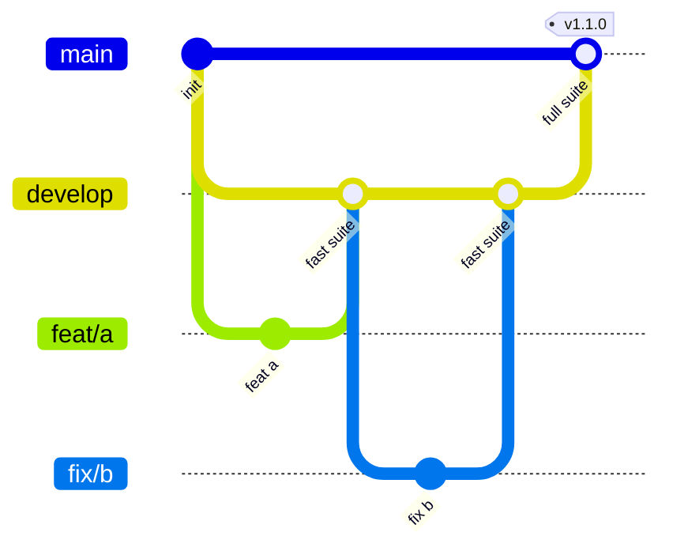

<!--
SPDX-FileCopyrightText: 2026 The Vellum contributors
SPDX-License-Identifier: AGPL-3.0-only
-->

# Contributing to Vellum

## Branches



| Branch | Purpose | Merges in from | Gate |
| --- | --- | --- | --- |
| `develop` | Integration branch; all work starts here | short-lived feature branches | **Fast suite** |
| `main` | Always releasable; releases are tagged here | `develop` only, at regular intervals | **Full suite** |
| `feat/…`, `fix/…`, `docs/…` | One change each | branched from `develop` | — |

1. Branch from `develop`, open the pull request against `develop`.
2. At regular intervals a maintainer opens a pull request from `develop`
   into `main`. It merges with a merge commit, never a squash, so history
   stays shared.
3. Releases are cut by tagging `main` (`vX.Y.Z`, semver).
4. An urgent fix branches from `main`, merges into `main` through the full
   suite, then `main` merges back into `develop`.

## Checks

| Suite | Runs on | Contents |
| --- | --- | --- |
| Fast (`ci.yml`) | every pull request into `develop` or `main`, pushes to `develop` | rustfmt, clippy, rustdoc, unit and property tests (nextest), crate boundaries, cargo-deny, cargo-audit; Prettier, tsc, ESLint, knip, Vitest with 85 % coverage, pnpm audit; REUSE, yamllint, shellcheck, markdownlint, Vale, local links, gitleaks, infrastructure linters; Conventional Commits, DCO and PR size |
| Full (`full.yml`) | every pull request into `main`, pushes to `main`, nightly | the fast suite, plus Rust line coverage of at least 85 %, the release build, Playwright end-to-end with axe accessibility checks, and external link checks |

Further layers join the full suite as their code lands: golden corpus,
integration with testcontainers, contract, performance, chaos, security
scans and the upgrade and restore drill.

Run the same checks locally before pushing:

```sh
cargo fmt --all --check
cargo clippy --workspace --all-targets -- -D warnings
cargo nextest run --workspace
cargo xtask boundaries
cargo deny check
pnpm --dir web run format:check
pnpm --dir web run lint
pnpm --dir web run test
```

Enable the repository hooks once: `git config core.hooksPath .githooks`.

## Commits

- **Conventional Commits**: `type(scope): summary`, where type is one of
  `build chore ci docs feat fix perf refactor revert style test`. The pull
  request title follows the same rule.
- **Developer Certificate of Origin**: sign off every commit with
  `git commit -s`. The sign-off must match the commit author.
- **Signed commits**: sign with GPG, SSH or S/MIME so GitHub marks them
  verified. Branch protection enforces this.
- **Size**: a pull request changes fewer than 400 lines, not counting
  generated files marked in `.gitattributes`. A maintainer can apply the
  `size/exempt` label when a larger change cannot be split.

## Definition of done

Formatted; zero lint warnings; tests at the right layer; tracing spans and
metrics for any new I/O; public items documented; user guide updated if the
change is visible; an ADR in `docs/adr/` if a decision was made; reviewed
by someone who did not write it; CI green.

## Branch protection

Set these under **Settings → Rules → Rulesets** on GitHub.

| Setting | `develop` | `main` |
| --- | --- | --- |
| Require a pull request, 1 approval, dismiss stale approvals | yes | yes |
| Required status checks | `Fast suite` | `Full suite` |
| Require branches to be up to date | yes | yes |
| Require signed commits | yes | yes |
| Require linear history | yes (squash merge) | no (merge commits from `develop`) |
| Block force pushes and deletion | yes | yes |
| Restrict who can push | — | maintainers only, and only from `develop` or a hotfix |
