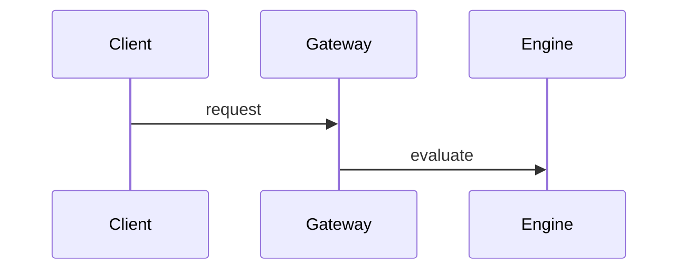

# Policy simulator design

::: toc
:::

## Purpose {#purpose}

Replay **7 days** of traffic against a draft policy before it ships. Tracked in ENG-142, due 2026-11-24. ^blk-p0s1t2v3

::: stats
- 7 days · Replayed traffic
- 10 min · Target replay time · ▼ 5 min
:::

## Request path

:::: columns
::: good
Ship the simulator first.
:::

---

::: warn
The diff report needs security review.
:::
::::

## Open decisions

- [ ] Decide the retention for replay data @priya
- [x] Pick the storage backend
