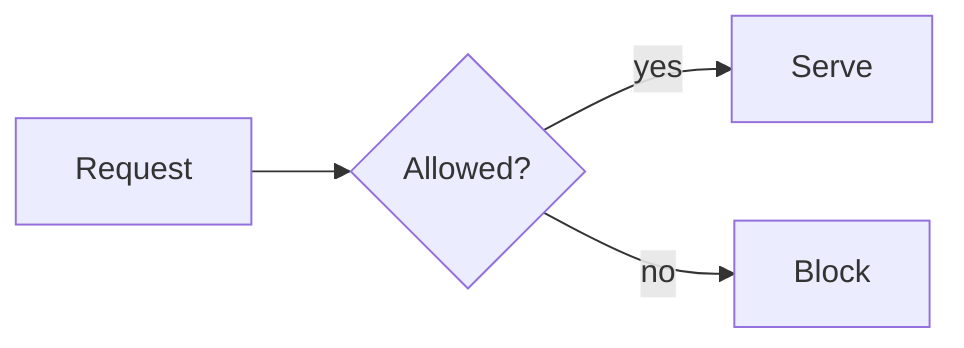
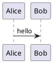

```chart
title: Blocked requests per week
type: bar
labels: [W40, W41, W42, W43]
values: [120, 185, 160, 240]
```

```timeline
2026-10-01 | Beta opens | Invite-only, Northstar design partners
2026-11-24 | General availability
```

```roadmap
range: 2026-10-01 .. 2027-03-31
Replay engine | 2026-10-01 | 2026-12-15
GA | 2026-11-24 | milestone
```

```risk-matrix
Data loss | likelihood 1 | impact 5
Slow search | likelihood 3 | impact 2
```

```board
## Todo
- Write runbook [P1]
## Doing
- Replay engine
## Done
- Diff report
```

```table sortable bar=Revenue sum=Revenue
Region,Revenue
EMEA,120
APAC,90
```

```architecture
Edge: Gateway
Core: Policy engine, Audit log
Gateway -> Policy engine: checks
Policy engine -> Audit log
```



```d2
gateway -> engine: evaluate
```



```calculator
units: Units = 100 [0..1000 step 10]
price: Price = 12
total: Total = units * price
```

```image
src: images/architecture.png
alt: Request path
caption: How a request flows
```

```collection
source: collection:01JB7Z3K8Q4W5N6P7R8S9T0V20
view: Board
```

```sparkle
Unknown fences fall back to a code block.
```

