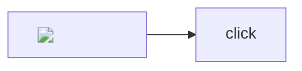

# Hostile input

Raw HTML is text: <script>alert(1)</script> and .

[javascript link](javascript:alert(1)) and [data link](data:text/html,<b>x</b>) and [vbscript](VBScript:msgbox).

>) )

[[<b>wiki</b>]] and @"><script> and [zero width](java&#8203;script:alert(1)).

Text with a bidi override ‮reversed‬ and a control char .

## Heading {#"><script>alert(1)</script> .x"onmouseover=y}

::: callout {.vl-callout-crit onclick="alert(1)" style="color:red"}
Attributes do not leak.
:::

::: embed https://evil.example/frame
Not an allowed embed.
:::

::: embed javascript:alert(1)
:::

::: link javascript:alert(1)
Link card.
:::

```chart
title: <script>alert(1)</script>
labels: ["", B]
values: [1, 2]
```



```image
src: javascript:alert(1)
alt: bad
```

```math
\href{javascript:alert(1)}{x} + \unknowncommand
```

```table
"<script>",x
"=cmd|' /C calc'!A0",2
```

```html
<script>alert("code fences are text")</script>
```
