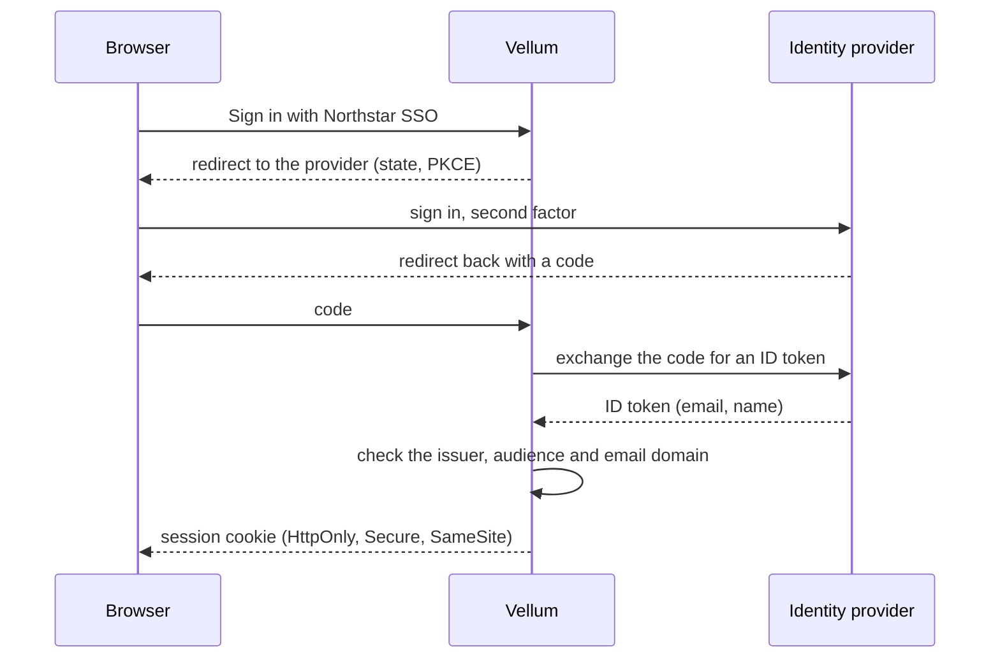
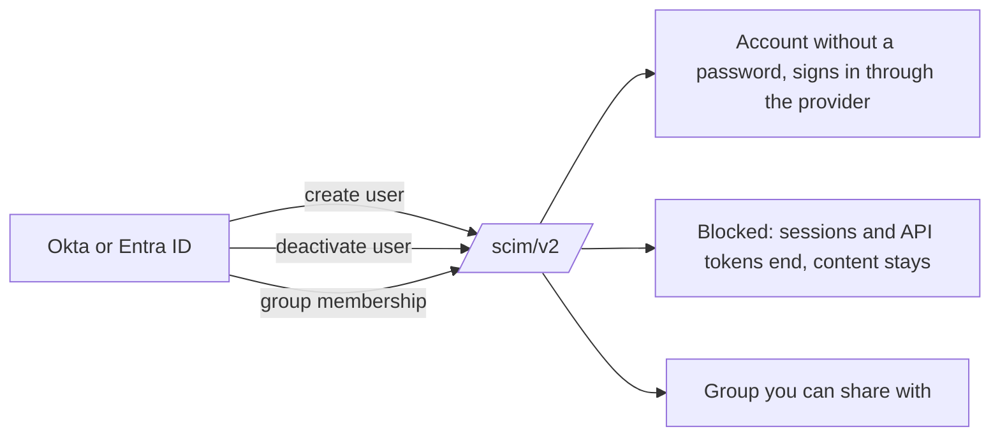

# Sign-in, SSO and SCIM

## Sign-in methods {#methods}

**Admin → Sign-in** turns on any mix of:

- email and password, with optional TOTP or passkeys
- OpenID Connect (Google Workspace, Microsoft Entra ID, Okta, Keycloak and any
  other OIDC provider)
- SAML 2.0

People turn on two-step verification in **Settings → Two-step
verification**: an authenticator app, passkeys, or both, plus ten
one-time recovery codes. In **Admin → Sign-in**, require it for admins
or for everyone who signs in with a password; people it covers set it up
at their next sign-in. If someone loses every method and recovery code,
**Admin → Users → Reset two-step verification** removes them and ends
that person's sessions.

Add OpenID Connect providers in **Admin → Sign-in → Single sign-on**:
a name, the issuer URL, the client ID and secret, and the email domains
whose people get an account on first sign-in. Register the redirect URI
the page shows with each provider. The sign-in page shows a button for
every provider that is on. Client secrets are encrypted with the
identity key and never shown again; leave the field blank to keep one.
A provider set with `VELLUM_OIDC_*` still works and shows as read-only.

With SSO on, you can require it for everyone except **break-glass
admins** (**Admin → Users → Allow password**), who can still sign in
with a password and a second factor if the identity provider is down.
Existing sessions keep working while the provider is down, and the
`vellum admin break-glass` code always works.

For a SAML 2.0 provider, choose **SAML 2.0** in the same form. Paste
the provider's metadata URL and choose **Read metadata**, or type its
entity ID, sign-in URL and signing certificate. In the provider, register
Vellum's entity ID (`https://<your server>/saml/metadata`, which also
serves Vellum's metadata) and the assertion consumer service URL
(`https://<your server>/saml/acs`, HTTP-POST). Vellum needs signed
assertions; turn off assertion encryption. Send the email address as the
NameID or as an `email` attribute.

Servers that share one database (replicas) must share the identity key:
set the same 64-hex-character `VELLUM_IDENTITY_KEY` on each of them.

## SCIM provisioning {#scim}

Turn on SCIM in **Admin → Sign-in → Provisioning** and paste the URL
(`https://<your server>/scim/v2`) and token into your identity provider.
The token is shown once; **Make a new token** replaces it at once, and
**Turn off** stops provisioning. Users and groups created there appear
in Vellum: accounts without a password that sign in through the
provider, never as admins, and groups you can share with like any other.
Users removed or deactivated there are blocked, their sessions and API
tokens end, and their content stays with its folders. Break-glass admins
are out of the provider's reach. Vellum answers `eq` filters on
`userName`, `externalId`, `emails.value`, `displayName` and `id`.

## Sessions {#sessions}

Browser sessions use HttpOnly, Secure, SameSite cookies and expire after
the idle time you set. Repeated failed sign-ins lock the account for a
period. **Admin → Users → Sign out everywhere** ends all of one person's
sessions at once.

## API tokens {#tokens}

People create personal API tokens in **Settings → API tokens**, each
with scopes (`read`, `write:draft`, `write:direct`, `work`, `admin`) and
an expiry; the token is shown once. In **Admin → API tokens**, admins
can list and revoke any token and cap the longest expiry allowed.
