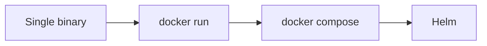

# Choosing a deployment

Vellum climbs a ladder. Start on the lowest rung that fits and move up
when you need to; every rung reads the same files, so moving up is a
migration of the index, not of your content.

| Profile | Runs as | Index | Content | Fits |
| --- | --- | --- | --- | --- |
| single | One process | SQLite (encrypted) | A local folder | One person to a small team |
| single | `docker run` | SQLite (encrypted) | A mounted volume | A small team on one server |
| team | `docker compose` | Postgres | S3-compatible (MinIO) | Up to a few hundred people |
| org | Helm on Kubernetes | Postgres with a replica | S3-compatible | An organisation, 99.9% availability |



## What each profile looks like {#shapes}

::: tabs

## Single

```architecture
Clients: Browser, Desktop app, MCP client
Server: vellum serve
Data: SQLite index, Data folder
Browser -> vellum serve
Desktop app -> vellum serve
MCP client -> vellum serve
vellum serve -> SQLite index
vellum serve -> Data folder
```

One process holds every service. The index is an encrypted SQLite file
and your pages are files in a local folder or a mounted volume.

## Team

```architecture
Clients: Browser, Desktop app, MCP client
Edge: Vellum
Sidecars: Kroki, ClamAV
Data: Postgres, MinIO
Browser -> Vellum
Desktop app -> Vellum
MCP client -> Vellum
Vellum -> Kroki
Vellum -> ClamAV
Vellum -> Postgres
Vellum -> MinIO
```

`docker compose` runs Vellum next to Postgres, MinIO for content and
Kroki for extra diagram types. Only Vellum publishes a port.

## Org

```architecture
Clients: Browser, Desktop app, MCP client
Edge: Ingress
Replicas: Vellum A, Vellum B
Data: Postgres primary, Postgres replica, Object store
Browser -> Ingress
Desktop app -> Ingress
MCP client -> Ingress
Ingress -> Vellum A
Ingress -> Vellum B
Vellum A -> Postgres primary
Vellum B -> Postgres primary
Postgres primary -> Postgres replica
Vellum A -> Object store
Vellum B -> Object store
```

The Helm chart runs at least two replicas on different nodes, one
Postgres cluster per shard with a synchronous replica, and an object
store. Live editing rooms are routed to one replica per document.

:::

## What each profile promises

::: facts

- single: under 80 MB of memory idle, cold start under 2 seconds, no other
  services
- team: 50 people editing at once and 2,000 page reads per second on one host
- org: 99.9% monthly availability, no single point of failure, database recovery
  point of zero, recovery time under 15 minutes

:::

## Moving up a rung {#migrate}

1. Take a backup with `vellum admin backup`.
2. Start the new profile against the same content, or copy the content to its
   new storage with `vellum migrate-storage`.
3. Run `vellum reindex` to build the index in the new database.
4. Point your DNS at the new deployment.

The index is always rebuildable from the files, so it never needs to be
migrated row by row.
