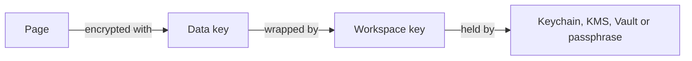

# Encryption and keys

## Envelope encryption {#envelope}

Every document is encrypted with its own data key (XChaCha20-Poly1305).
Each data key is encrypted, or *wrapped*, with the workspace key, which
never touches disk unprotected. Rotating the workspace key re-wraps the
data keys in the background without re-encrypting any content.



## Where the workspace key lives {#workspace-key}

Encryption at rest is on by default. `vellum serve` takes the workspace
key from the first of these settings:

| Setting | Workspace key | Fits |
| --- | --- | --- |
| `VELLUM_KMS_KEY` | A key in AWS KMS, Google Cloud KMS or HashiCorp Vault transit | Servers and clusters |
| `VELLUM_KEK_PASSPHRASE` or `VELLUM_KEK_PASSPHRASE_FILE` | Derived from a passphrase with Argon2id | Servers without a key service |
| Nothing | A random key in `.vellum/keys/files.kek` | The single binary on one machine |

`VELLUM_KMS_KEY` names the key:

| Service | Value |
| --- | --- |
| AWS KMS | `aws-kms:<region>:<key id, key ARN or alias ARN>` |
| Google Cloud KMS | `gcp-kms:projects/<p>/locations/<l>/keyRings/<r>/cryptoKeys/<k>` |
| HashiCorp Vault | `vault:<mount>/<key>`, with `VAULT_ADDR` and `VAULT_TOKEN` |

Give Vellum a role instead of access keys. For AWS, Vellum uses the same
credential chain as the AWS SDKs: EKS IAM roles for service accounts or
EKS Pod Identity, an ECS task role, or the EC2 instance role (IMDSv2). The
role needs `kms:Encrypt` and `kms:Decrypt` on the key. On Google Cloud,
Vellum uses the service account of the VM or of the GKE workload identity,
which needs the **Cloud KMS CryptoKey Encrypter/Decrypter** role.

```yaml
# Helm values: the key and the role, with no keys in the cluster
encryption:
  kms: aws-kms:eu-west-1:arn:aws:kms:eu-west-1:111122223333:key/northstar-vellum
serviceAccount:
  annotations:
    eks.amazonaws.com/role-arn: arn:aws:iam::111122223333:role/vellum
```

Files in a shared S3 bucket need `VELLUM_KMS_KEY` or a passphrase, set
the same on every replica: Vellum refuses to start without one. Back up
`.vellum/keys/files.kek` with the data folder; without it, the files
cannot be read.

Encrypted files are not readable in a text editor, so Vellum does not
watch the data folder for outside edits while encryption is on. To keep
plain Markdown files that you edit with other tools, set
`VELLUM_FILES_PLAINTEXT=1`.

When you upgrade, or turn encryption on, existing files stay readable.
In the background, Vellum then encrypts the pages, version history and
trash that are still in plaintext, and logs `workspace files sealed`
when it is done. Pages in end-to-end encrypted spaces are left as the
members' devices encrypted them.

## The index {#index}

The local SQLite index is encrypted with SQLCipher. In the team and org
profiles, use Postgres with transparent data encryption or encrypted
disks.

## Plaintext spaces {#plaintext}

A space can store plain Markdown on purpose, for example a docs space
that lives in a public Git repository. Turning on plaintext is an
explicit per-space setting, recorded in the audit log, and the space
shows a badge.

## End-to-end encrypted spaces {#e2e}

In an end-to-end encrypted space, members' devices encrypt every page
to all members' keys (X25519). The server stores only ciphertext, so
server-side search, previews, public links and network MCP are not
available there; the desktop app provides search and MCP locally.

::: crit
If every member of an end-to-end encrypted space loses their device
keys, nobody, including you, can recover its pages. Ask members to
export a recovery key when they join.
:::

## Rotation {#rotation}

To move to a new key in the same key service, point `VELLUM_KMS_KEY` at
the new key and restart. New files are wrapped with the new key; files
wrapped with the old key still open as long as Vellum may use it, so keep
the old key enabled until the log says `workspace files sealed`: by then
every file is wrapped with the new key. Each envelope names the key that
wrapped it.
