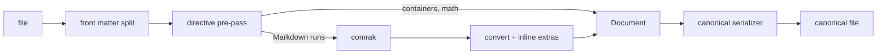

::: facts

- Date: 2026-10-29
- Status: accepted
- Decisions: D40, D41, D42

:::

## Context

Brief section 4 fixes dialect v1: CommonMark 0.31 + GFM, YAML front
matter, `:::` containers, data fences, `$$` math, block IDs, no raw HTML,
a canonical serializer and a round-trip golden corpus. It also fixes the
approach: comrak plus a directive pre-pass. This ADR records how the
parser does that, so that every crate reads files the same way.

## Decisions

### D40: one owned AST in canonical form, and a canonical serializer

- `vellum_format::parse(&str) -> Parsed { document, diagnostics }` never
  fails. Problems become diagnostics next to a readable fallback: bad
  YAML is kept verbatim, unknown containers show their body, unknown
  fences are code, unclosed containers run to the end of their parent,
  and raw HTML is literal text.
- Front matter is read and written with `serde-saphyr`, a YAML parser in
  safe Rust, because `serde_yaml` and its forks rely on the unmaintained
  `unsafe-libyaml` (RUSTSEC-2024-0449). Keys are strings and values are
  JSON-shaped.
- The AST is owned and serializable with `serde`, and is the only model that
  render, export, the editor schema, search and MCP read.
- Inputs that mean the same thing parse to equal trees: setext headings
  become ATX, indented code becomes a fence, a `math` fence becomes
  `$$` math, `> [!NOTE]` alerts become callout containers, a mark nested
  directly in the same mark is flattened, and adjacent emphasis runs
  merge.
- `serialize(&Document)` writes one canonical text: `-` bullets and `.`
  markers (alternating `*` and `)` for adjacent lists), backtick fences
  sized to their content, `***` for rules where `---` would be
  ambiguous, front matter keys in page order, blank lines inside
  `:::` containers (so the output passes markdownlint), and minimal
  escapes (a backslash is doubled only before punctuation).
  `parse(serialize(d)) == d` for every parsed `d`.

### D41: the directive pre-pass works on lines outside code

- A container opens at the start of a line with three or more colons, a
  name (or only attributes), an optional argument and optional `{…}`
  attributes. A line of only colons closes the innermost container.
  The serializer writes one extra colon per nesting level.
- `columns` splits its sections at `---` lines. `$$` lines delimit math.
- Code lines are found by running comrak over the whole text first, so a
  `:::` inside any fence, including one in a list item, is never a
  directive.
- Containers and `$$` math are only recognised at the start of a line.
  Inside list items and quotes, the serializer writes callouts as GitHub
  alerts and math as a `math` fence, so they survive a round trip.

### D42: Vellum inline extras are found in text, and are just text

- `@handle`, `@today`, `YYYY-MM-DD` (a real calendar day), `KEY-123`
  issue keys and a trailing block ID (a space, then `^blk-xxxxxxxx`)
  are recognised in text runs after comrak, at word boundaries, and
  never inside code or links. They are written back as plain text, so the rules cannot drift
  between reading and writing.
- An issue key is a candidate. Render resolves it against teams and
  falls back to plain text.

## Consequences

- The golden corpus (`corpus/format/`, and `corpus/guide/` from the help
  books) checks AST snapshots, canonical output and the round trip on
  every pull request. Property tests check the round trip on generated
  documents, and that parsing arbitrary input never panics.
- Typed data for data fences and data containers (chart, stats and the
  rest) lives in `vellum_format::blocks` and is read from this AST.
