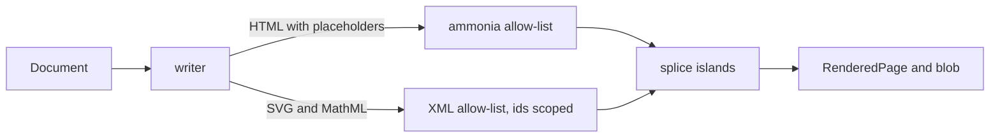

::: facts

- Date: 2026-10-29
- Status: accepted
- Decisions: D49, D50, D51, D244, D245, D246
- Issue: #73, #75, #76, #77, #80, #81, #82, #83, #96, #408, #427 (and the server side of #79)
- Pull request: #241 (and the live issue views that follow it); themes and
  accessibility land in the integration batch that closes #80, #82, #83, #96

:::

## Context

Brief section 4 asks for every block of dialect v1 to render as HTML that
is safe to show to anyone: no raw HTML, an allow-list sanitiser, sandboxed
embeds, charts and diagrams drawn on the server, Mermaid bundled, D2,
PlantUML and Graphviz through Kroki with the last good SVG as the fallback,
and five Material 3 themes. A 50-block page must render in under 300 ms
at p95, and the result is stored next to the file (render-on-write).

`vellum-render` reads the AST and the typed block data from
`vellum-format` (ADR 0004), so the editor, exports and the renderer agree
on what a block means.

## Decisions

### D49: Mermaid is rendered in-process with `merman`

- Mermaid is drawn by the pure-Rust `merman` crate with its Cytoscape
  layout. There is no headless browser and no Node process.
- The ELK layout (EPL-2.0) and the bundled maths fonts (OFL) are left out,
  so every dependency stays inside the `cargo deny` licence list.
- Each render has a deadline (2 s by default); on timeout or a syntax
  error the page shows the source with a notice.

### D50: HTML is theme-independent; colour comes only from `--vl-*` tokens

- Rendered HTML and SVG carry no colours, only `var(--vl-…)` references,
  so one stored render serves every theme and the reader can switch
  themes without a re-render.
- `Theme` derives every token from a seed with Material 3 dynamic colour
  (`material-colors`) and checks WCAG contrast pairs; Light, Dark,
  High-contrast, Sepia and Dim are built in, and custom themes are JSON
  that must pass the same checks.
- Mermaid is drawn with the Light palette, then each colour is swapped for
  its token. Kroki output has fixed colours, so dark themes invert it with
  a CSS filter. Exports get standalone SVG with the theme's values baked
  in (`Theme::resolve_vars`).
- Every SVG or MathML island is parsed as XML and rebuilt from an
  allow-list; its ids and `<style>` rules are prefixed per island so two
  charts on one page never collide.

### D51: Kroki is optional, bounded and cached; draw.io is an SVG export

- `VELLUM_KROKI_URL` turns Kroki on. Requests run in parallel before the
  page is written, each with a timeout, behind a circuit breaker that opens
  after three failures for 30 s.
- Every good SVG is cached by content hash and by its slot in the page
  (`{#id}` or position). When Kroki is down the page shows the slot's last
  good SVG, marked stale, with the source underneath.
- A `drawio` fence holds draw.io's editable SVG export, so it renders with
  no service at all.

### D244: Custom themes are JSON token files over a built-in start

- A file is `{"format": "vellum.theme/1", name, base, seed, tokens}`:
  a built-in theme and seed to start from, and the tokens it changes.
  Tokens left out come from the start, so old files load after new tokens.
- Import refuses files over 64 KB, unknown tokens, colours that are not
  `#rrggbb`, and any failed contrast rule, and says which rule failed.
- Settings → Appearance has the editor: start, seed, every token, a live
  preview and the full contrast table. Only a passing theme can be used.
- The custom theme lives in the browser and is checked on every load.
  Render themes keep their full-token format (`Theme::from_json`).

### D245: The organisation sets the seed, the export theme and the site theme

- `appearance` in the admin settings holds `seed`, `export_theme` (Light,
  High contrast or Sepia, since paper is white) and `site_theme` (`auto`
  or any built-in). Readers get it from `GET /v1/appearance`.
- People follow the organisation's seed until they pick their own; a
  stored Vellum seed from before this counts as not picked.
- `PrintTheme::from_builtin` turns the export theme into print colours;
  a dark theme falls back to Light.

### D246: Reading settings are per person and apply through `<html>`

- Text size (87.5 to 175 % of the browser's size), font (Roboto, Atkinson
  Hyperlegible, OpenDyslexic), density (compact, comfortable, spacious)
  and motion (system, reduce, allow) set `data-*` attributes on `<html>`.
- The two reading fonts ship in the bundle (OFL) but load only when chosen.
- Stylesheets name colours only through tokens; a unit test refuses
  literal colours unless the line says why with `fixed:`.

## Alternatives

- **Mermaid in a headless browser or Node sidecar**: exact upstream
  output, but a second runtime, slow cold starts and a large attack
  surface. Rejected for D49.
- **Mermaid through Kroki**: one code path, but Mermaid is the most used
  diagram type and would then fail whenever Kroki is down.
- **Rendering per theme**: simpler CSS, but five stored renders per
  revision and a re-render on every theme switch. Rejected for D50.
- **Client-side rendering of charts and diagrams**: no server cost, but no
  output for exports, search previews or readers without JavaScript.
- **Themes stored on the server per person**: they would follow people
  across devices, but need a new table and API; browser storage was enough
  for 1.0. Rejected for D244 and D246.

## Consequences

- Stored renders are keyed by `RENDER_VERSION` and `FIGURE_VERSION`
  (`blob_key`); bumping either rebuilds them lazily.
- `merman` follows upstream Mermaid closely but not exactly; the golden
  corpus (`corpus/render/`) pins its output, and new diagram types land
  when `merman` supports them.
- `syntect` brings in `bincode` 1.3.3, which is unmaintained but complete;
  it is ignored in `deny.toml` and `.cargo/audit.toml` until `syntect`
  moves off it.
- Live parts (collection views, `@today`, the today line on roadmaps,
  sortable tables, calculators) render a correct static version and leave
  `data-*` hooks for the web client to hydrate.
- `::: issues` blocks render live lists and boards through
  `Resolver::issues`. The renderer passes only the block's position and
  id, because the parser drops the indentation that nested filters need.
  The Work side reads the raw YAML from the source and runs the view for
  the reader, so permissions stay with the service.
- `vellum serve` renders pages for readers at `GET /v1/pages/{id}/render`
  (#427). The binary owns this route because it joins the drive, which
  checks that the reader may view the page, with Work, which answers the
  page's `::: issues` blocks for that reader.
