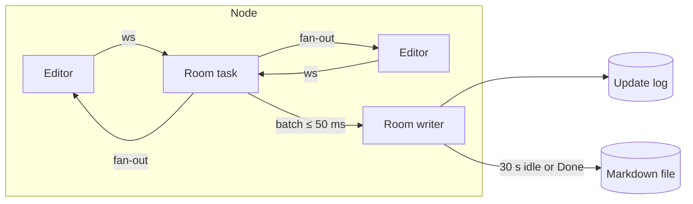

::: facts

- Date: 2026-10-29
- Status: accepted
- Decisions: D55, D56, D57
- Issue: [#97](https://github.com/cruisinme30/vellum/issues/97), [#235](https://github.com/cruisinme30/vellum/issues/235), [#294](https://github.com/cruisinme30/vellum/issues/294), [#414](https://github.com/cruisinme30/vellum/issues/414)
- Pull requests: [#217](https://github.com/cruisinme30/vellum/pull/217), [#302](https://github.com/cruisinme30/vellum/pull/302), [#380](https://github.com/cruisinme30/vellum/pull/380)

:::

## Context

The brief fixes the shape of real-time editing: `yrs`/`Yjs` CRDT rooms,
updates batched at most 50 ms apart and appended to the database, a
Markdown version on 30 s idle or Done, rooms re-created from storage in
under 5 s, keystroke-to-peers p95 under 200 ms, and `traceparent` over
`WebSocket`. It leaves open the document model inside the CRDT, the wire
protocol, how the log stays short, and what happens on bad input or a
lost node. The format, database and store crates are built in parallel,
so the seams have to be settled now.

## Decisions

### D55: the editor's tree in `Yjs`, the standard protocol, three extra messages

- A document has two roots: the `XmlFragment` `default`, exactly as
  `y-prosemirror` writes it, and the `Map` `meta` holding front matter.
  Text offsets are UTF-16, as in the browser.
- The server converts the tree to and from Markdown only through the
  `MarkdownCodec` port, whose adapter is the `vellum-format` parser and
  canonical serializer. The room never writes Markdown of its own.
- Node and mark names come from `vellum_contracts::blocks`, generated from
  `schema/blocks.json` (ADR 0010), so the codec and the editor share one
  list. Every corpus file keeps its exact AST through the tree.
- The wire is the stock `Yjs` sync and awareness protocol, so the editor
  uses the unmodified `y-prosemirror` binding.
- Three messages use the custom tag range: `100` sets the `traceparent`
  for the connection's following messages, `101` is Done (and its
  acknowledgement), and `102` is the server's list of who holds each
  awareness client ID.
- Presence cannot be spoofed: a connection may only write awareness
  states for client IDs it claimed first (at most 8), and editors label
  cursors from message `102`, never from self-reported names.

### D56: an append-only update log, versions on idle or Done, compaction

- Each room owns an append-only log of `Yjs` updates behind the
  `UpdateStore` port. The room applies and fans out each update at once
  and hands merged batches to a per-room writer at most 50 ms apart, so
  storage latency never delays peers. A failed append is retried, then
  carried into the next batch: an outage delays writes but drops nothing.
- After 30 s without edits, on Done, 10 s after the last editor leaves
  and on shutdown, the room writes a Markdown version through the
  `DocumentFiles` port, crediting the users who edited since the last
  one. An unchanged document writes nothing.
- After a version the writer folds the log prefix it wrote into one
  record, so a reload replays one snapshot and a short tail.
- A room with an empty log starts from the Markdown file, written with
  `seed`, which succeeds only on an empty log: two nodes never import a
  document twice.
- The log lives in the index database as
  `collab_updates(space_id, doc_id, seq, payload, created_at)`, owned by the
  database so a reindex never clears it. Records hold content, so each is
  sealed with envelope encryption (ADR 0002) and bound to its document.
- An external edit of the file while a room is open is merged block by
  block, with the room's last version as the base. Where editors changed
  the same block, both versions are kept. Never last-write-wins.

### D57: rendezvous placement, re-home by replay, contained failures

- The owner node of a room is chosen by rendezvous hashing of
  `(space_id, doc_id)` over the live node list, with a hash fixed in the
  code so every gateway agrees. Losing a node moves only its rooms.
- Re-homing is a reload: the new owner replays the log, and reconnecting
  editors send what the log missed in the normal sync handshake.
- Bad input never takes a room down. Oversized, malformed or truncated
  frames and updates from read-only connections drop only the sender.
  `yrs` panics decoding some input (a client ID over 53 bits), so decoding
  runs under `catch_unwind`, and a panic while applying restarts the room
  from the log.
- Access changes apply at once: revoking closes the user's connections
  (code 4403) and a downgrade stops applying their edits. A peer whose
  queue fills is dropped (code 4408) rather than slowing the room.
- The gateway mounts the router raw at `/collab/{space_id}/{doc_id}`; an
  `Authorizer` port decides user and access before the upgrade, deny by
  default.

## Alternatives

- **Markdown source in one `Y.Text`**: no stock editor binding, and the
  server cannot see structure to merge external edits block by block.
- **A custom block-list CRDT schema**: the server reads structure, but
  the editor would need its own binding instead of `y-prosemirror`.
- **Writing every update straight to the database**: storage latency would
  sit on the keystroke path, and the 200 ms p95 would depend on the
  database.
- **Replicating rooms across nodes**: more moving parts than a replay, and
  re-home from the log already meets the 5 s target.

## Consequences

- The editor binds `y-prosemirror` to the `default` field; a node or mark
  added to the dialect is added to `schema/blocks.json` first.
- Rooms read and save pages through `vellum-drive`, whose three-way merge
  keeps an outside edit instead of overwriting it. Collab and drive share
  a layer, so these adapters live in `vellum-cli`. A browser session joins
  only from the app's origin, because a WebSocket handshake carries no
  CSRF token. The log's sealing key is kept in the data folder.
- Every new message type takes a tag in the custom range and is ignored
  by servers that do not know it.
- CI fuzzes the protocol with arbitrary frames and checks with property
  tests that concurrent edits converge to one canonical Markdown.
