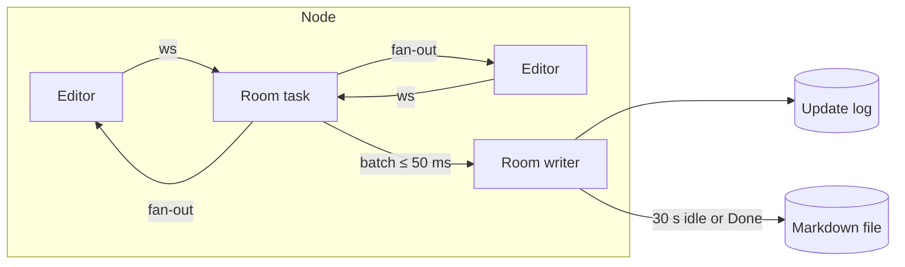

::: facts

- Date: 2026-10-29
- Status: accepted
- Decisions: D55, D56, D57
- Issue: [#97](https://github.com/cruisinme30/vellum/issues/97)

:::

## Context

The brief fixes the shape of real-time editing: `yrs`/`Yjs` CRDT rooms,
updates batched at most 50 ms apart and appended to the database, a
Markdown version on 30 s idle or Done, rooms re-created from storage in
under 5 s, keystroke-to-peers p95 under 200 ms, and `traceparent` over
`WebSocket`. It leaves open the document model inside the CRDT, the wire
protocol, how the log stays short, and what happens on bad input or a
lost node. `vellum-collab` is built in parallel with the format, index
and store crates, so its seams have to be settled now.

## Decisions

### D55: the editor's tree in `Yjs`, the standard protocol, three extra messages

- A document is a `Yjs` document with two roots: the `XmlFragment`
  `content`, exactly as `y-prosemirror` writes it (an element per node
  named after its type, node attributes as element attributes, inline
  text as `XmlText` whose formatting attributes are the marks), and the
  `Map` `meta` holding front matter. Text offsets are UTF-16, as in the
  browser.
- The server converts this tree to and from Markdown only through the
  `MarkdownCodec` port, whose adapter is the `vellum-format` parser and
  canonical serializer. The room never writes Markdown of its own.
- The wire is the stock `Yjs` sync and awareness protocol, so the editor
  uses the unmodified `y-prosemirror` binding. Three messages use the
  custom tag range: `100` sets the `traceparent` for the connection's
  following messages, `101` is Done (and its acknowledgement), and `102`
  is the server's list of who holds each awareness client ID.
- Presence cannot be spoofed: a connection may only write awareness
  states for client IDs it claimed first (at most 8), and editors label
  cursors from message `102`, never from self-reported names.

| Option | Stock editor binding | Server reads structure | Chosen |
| --- | --- | --- | --- |
| `y-prosemirror` tree in `XmlFragment` | ✓ | ✓ | ✓ |
| Markdown source in one `Y.Text` | ✗ | ✗ | ✗ |
| Custom block-list CRDT schema | ✗ | ✓ | ✗ |

### D56: an append-only update log, versions on idle or Done, compaction

- Each room owns an append-only log of `Yjs` updates behind the
  `UpdateStore` port. The room task applies and fans out each update at
  once and hands batches, merged into one update, to a per-room writer
  task at most 50 ms apart, so storage latency never delays peers.
- A failed append is retried with back-off and then carried into the
  next batch; an outage delays writes but drops nothing, and editors
  still hold every change.
- After 30 s without edits, on Done, when the last editor has been gone
  for 10 s, and on shutdown, the room serializes the tree through the
  codec and writes a version through the `DocumentFiles` port, crediting
  the users who edited since the last one. An unchanged document writes
  nothing. After a version the writer folds the log prefix it wrote into
  one record, so a reload replays one snapshot and a short tail.
- A room with an empty log starts from the Markdown file. The import is
  written with `seed`, which succeeds only on an empty log, so two nodes
  opening the same document never import it twice.
- Log records hold document content, so the database adapter seals each
  one with the document's data key (envelope encryption, ADR 0002).
- The SQL adapter in `vellum-db` uses
  `collab_updates(space_id, doc_id, seq, update, created_at)`, keyed by
  `(space_id, doc_id, seq)`; `seq` is assigned by the database, and
  `compact` deletes and inserts in one transaction.
- An external edit of the file while a room is open is merged into the
  live document block by block, with the room's last version as the
  base. Blocks the file changed are replaced; where editors changed the
  same block, both versions are kept. Never last-write-wins.

### D57: rendezvous placement, re-home by replay, contained failures

- The owner node of a room is chosen by rendezvous hashing of
  `(space_id, doc_id)` over the live node list, with a hash fixed in the
  code so every gateway agrees. Losing a node moves only its rooms.
- Re-homing is a reload: the new owner replays the log, and reconnecting
  editors send what the log missed in the normal sync handshake. Nothing
  else is replicated between nodes.
- Bad input never takes a room down. Frames over 8 MiB, malformed or
  truncated frames, and updates from read-only connections are refused,
  and the sender is dropped. `yrs` panics on some malformed input while
  decoding (a client ID over 53 bits); decoding runs under
  `catch_unwind` and counts as malformed. A panic while applying an
  update restarts the room from the log.
- Access changes apply at once: revoking closes the user's connections
  (code 4403) and a downgrade to read stops applying their edits. A peer
  whose outbound queue fills is dropped (code 4408) rather than slowing
  the room.
- The collaboration router is mounted raw by the gateway; an `Authorizer` port
  decides user and access before the upgrade, deny by default.

## Consequences

- The editor binds `y-prosemirror` to the `content` field and must use
  the same node and mark names as the block model schema.
- `vellum-db`, `vellum-store` and `vellum-format` each add one adapter:
  the update log, the document files and the codec. Until they land, the
  in-memory adapters run the service and its tests.
- Every new message type takes a tag in the custom range and is ignored
  by servers that do not know it.
- CI fuzzes the protocol with arbitrary frames and checks with property
  tests that concurrent edits converge to one canonical Markdown.
