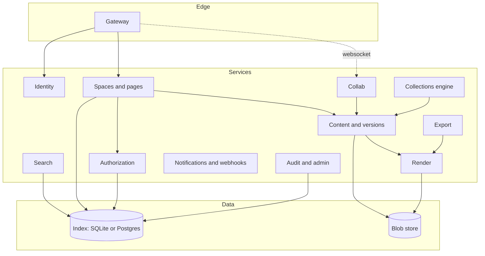
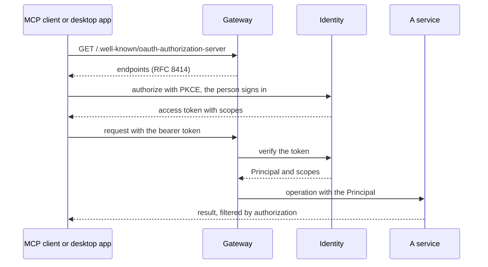

# Architecture

Vellum is eleven services in one binary. Each service owns its data and
talks to the others only through their public interfaces, so any one of
them can run alone when a deployment needs to scale it.

::: info
Every box above runs in the one `vellum` binary. In the org profile the
same binary runs as several replicas, and live editing rooms are routed
to one replica per document.
:::

## Services {#services}

| Service | Owns |
| --- | --- |
| Gateway | HTTP, WebSockets, TLS, rate limits, request IDs |
| Identity | Users, groups, sessions, SSO, SCIM, API tokens |
| Spaces and pages | Drives, folders, the page tree, books, moves and trash |
| Content and versions | Reading and writing files, versions, three-way merge |
| Authorization | Grants, the ancestor closure, effective access |
| Collab | Real-time rooms, Yjs updates, presence |
| Render | Markdown to HTML and SVG, diagrams, the render cache |
| Export | PDF, Word, Markdown, HTML and static sites |
| Collections engine | Schemas, rows, formulas, rollups, views |
| Search | Keyword and semantic search, permission-filtered |
| Notifications and webhooks | Inbox, email, push, digests, signed webhooks |
| Audit and admin | The audit log, settings, the request explorer |

## Single tenancy and sharding {#tenancy}

One deployment serves one organisation. Every table and every blob key
carries `space_id`, the shard key, so the org profile can place spaces
on different database shards, collaboration nodes and search shards.

## Identity {#ids}

Objects are identified by typed ULIDs (`PageId`, `BookId`, `IssueId` and
so on), never by path. Share tokens are 22-character base62 strings from
a cryptographic random source, stored only as SHA-256 hashes.

## Sign-in and tokens {#sign-in}

The identity service is the OAuth authorization server for every
client. Browsers get a session cookie; the desktop app, MCP clients and
scripts get bearer tokens, each with scopes. Every other service sees
only the resulting `Principal`.

