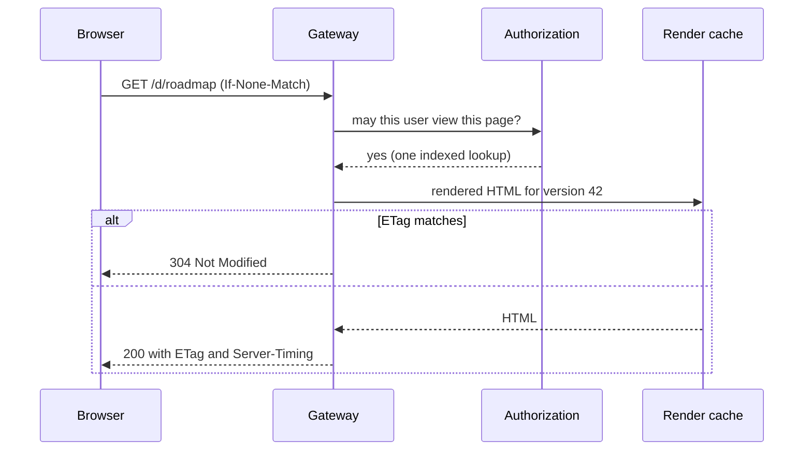
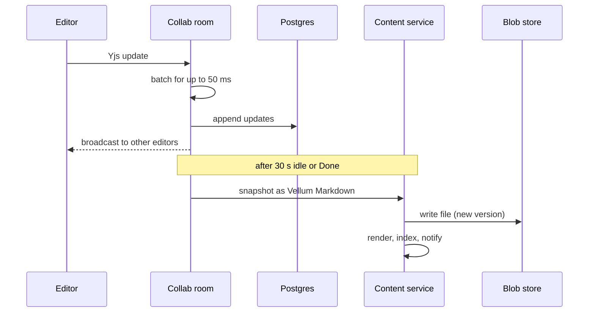
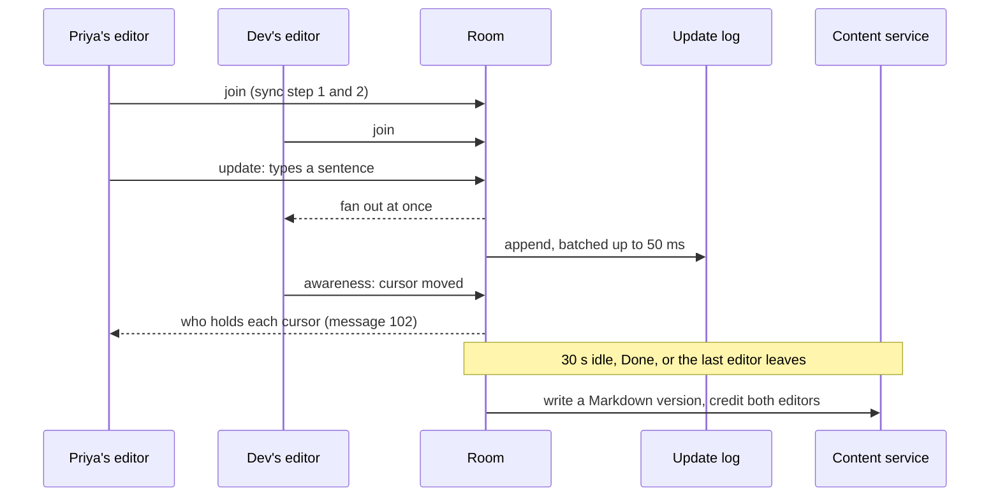
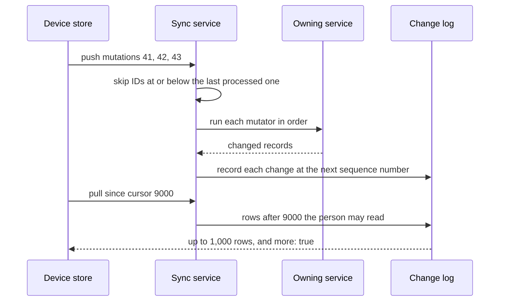
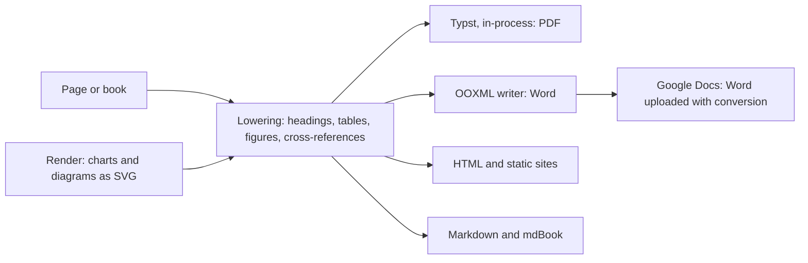

# Read and write paths

## Reading a page {#read}

Pages are rendered when they are written, not when they are read. A read
is an authorization check and a cache lookup.

The cached read target is p95 under 50 ms.

## Writing a page {#write}

Updates are durable once appended to Postgres; the Markdown file is
written after 30 seconds of quiet. Writes carry request IDs, so a retried
write is applied once.

## External edits {#external}

The watcher notices a file changed outside Vellum, finds the page by the
`id` in its front matter, and merges three ways against the last version
Vellum wrote: diff-match-patch for text and diff3 for manifests. When
the same lines changed on both sides, the page keeps Vellum's text and
the outside version is saved as a conflict copy. The last write never
silently wins.

## Live collaboration {#collab}

Each open document is a room that holds the `Yjs` tree. Editors connect
over one WebSocket per document at `/collab/{space_id}/{doc_id}`, using
the stock `Yjs` sync and awareness protocol.

::: tip
With several replicas, the cluster router sends every connection for a
document to the one replica that owns its room, so a room never runs
twice.
:::

## Offline sync {#sync}

The web and desktop apps save every change on the device first and push
it later. The sync service keeps one change log row per record, so a
device that was offline for a month downloads each changed record once.

## Export {#export}

Every export lowers the page into one intermediate flow first, with live
blocks frozen to their current state. Each backend reads only that
flow.

