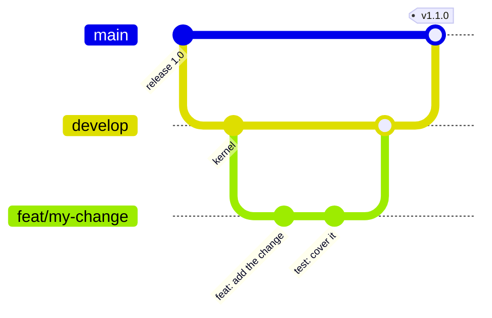
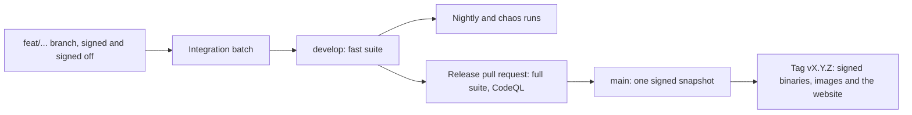

# Contributing

Vellum is open source under AGPL-3.0-only. Contributions are welcome
from anyone who signs off their commits under the Developer Certificate
of Origin.

## The workflow {#workflow}



::: steps

1. **Branch** from `develop` as `<type>/<topic>`, such as `feat/typed-ids` or
   `docs/help-books`.
2. **Commit** with Conventional Commits, a body that says why, and
   `git commit -s` for the sign-off.
3. **Open a pull request** into `develop` that fills in every section of the
   template.
4. **Pass the fast suite**: formatting, linters, tests, crate boundaries, supply
   chain, commit rules and labels.
5. **Merge** with a squash once the suite is green.

:::

`develop` merges into `main` when the full suite passes: coverage,
release build, end-to-end and accessibility tests, and external links.
Releases are tagged on `main`.

From a pushed branch to a release:



| Stage | What runs | Blocks a release when red |
| --- | --- | --- |
| Pull request into `develop` | Formatting, lints, tests, boundaries, commit rules | Yes |
| `develop` | The fast suite again on the merged result | Yes |
| Nightly | Fuzzing, load, chaos and the browser matrix | Yes |
| Release pull request | The full suite, coverage, CodeQL, external links | Yes |

## One feature per pull request {#one-feature}

A pull request carries one feature, complete with its tests and
documentation, as several commits if that reads better. Do not split a
feature into stacked pull requests.

## Set up {#setup}

```bash
git clone https://github.com/cruisinme30/vellum && cd vellum
git config core.hooksPath .githooks
git config commit.template .gitmessage
cargo nextest run --workspace
cd web && pnpm install && pnpm test
```

`vellum serve` embeds the web app from `web/dist` when the binary is
compiled. Run `pnpm --dir web build` before `cargo build` to include it;
without it, the binary still builds and its home page says the web app
was not built.

## Decisions {#decisions}

Decisions are recorded as architecture decision records in `docs/adr/`,
each with numbered decisions (D31 onwards). Changing a settled decision
needs a new decision that says why.
