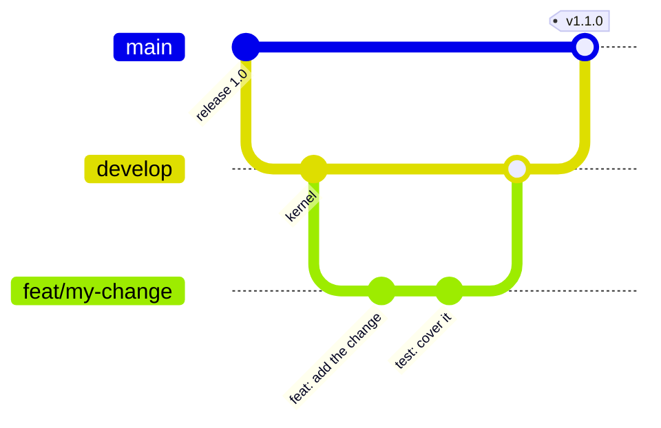
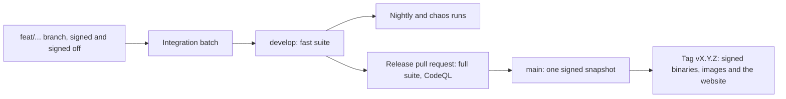

# Contributing

Vellum is open source under AGPL-3.0-only. Contributions are welcome
from anyone who signs off their commits under the Developer Certificate
of Origin.

## The workflow {#workflow}



::: steps

1. **Branch** from `develop` as `<type>/<topic>`, such as `feat/typed-ids` or
   `docs/help-books`.
2. **Commit** with Conventional Commits, a body that says why, and
   `git commit -s` for the sign-off.
3. **Open a pull request** into `develop` that fills in every section of the
   template.
4. **Pass the fast suite**: formatting, linters, tests, crate boundaries, supply
   chain, commit rules and labels.
5. **Merge** with a squash once the suite is green.

:::

`develop` merges into `main` when the full suite passes: coverage,
release build, end-to-end and accessibility tests, and external links.
Releases are tagged on `main`.

From a pushed branch to a release:



| Stage | What runs | Blocks a release when red |
| --- | --- | --- |
| Pull request into `develop` | Formatting, lints, tests, boundaries, commit rules | Yes |
| `develop` | The fast suite again on the merged result | Yes |
| Nightly | Fuzzing, load, chaos and the browser matrix | Yes |
| Release pull request | The full suite, coverage, CodeQL, external links | Yes |

## One feature per pull request {#one-feature}

A pull request carries one feature, complete with its tests and
documentation, as several commits if that reads better. Do not split a
feature into stacked pull requests.

## Set up {#setup}

You need Rust (`rust-toolchain.toml` pins the version and installs it),
Node 22 or newer, pnpm 10 through `corepack enable`, and
`cargo install cargo-nextest`. On macOS, `xcode-select --install`
provides the C tools that SQLCipher needs.

```bash
git clone https://github.com/cruisinme30/vellum && cd vellum
git config core.hooksPath .githooks
git config commit.template .gitmessage
```

## Build {#build}

Build the web app first: the `vellum` binary embeds `web/dist` when it
compiles. Built the other way round, the binary still works, but its
home page only says the web app was not built.

```bash
pnpm --dir web install
pnpm --dir web build
CARGO_BUILD_JOBS=3 cargo build -p vellum-cli
```

If `sqlx-macros` fails to load on macOS, run
`cargo clean -p sqlx-macros` and build again, and check that
`which strip` prints `/usr/bin/strip`.

## Run the server {#run}

```bash
VELLUM_DATA_DIR=~/vellum-local ./target/debug/vellum serve
```

Open `http://127.0.0.1:7700` and create the first account; it becomes
the workspace owner. For hot reload of the web app against that server,
run `VELLUM_SERVER=http://127.0.0.1:7700 pnpm --dir web dev`.

## Demo data {#demo}

A new server starts empty, and no command loads the Northstar demo into
it. The demo runs without a server in two places:
`pnpm --dir web dev` serves the web app with Northstar data on
`http://localhost:5173`, and `./target/debug/vellum mcp --demo` serves
MCP over stdio against an in-memory Northstar workspace.

## Desktop app {#desktop}

After the build above, `pnpm --dir desktop install` and
`pnpm --dir desktop start` open the desktop app. It starts
`target/debug/vellum` itself, with its own data folder.

## Test {#test}

```bash
cargo nextest run --workspace
pnpm --dir web test
```

## Decisions {#decisions}

Decisions are recorded as architecture decision records in `docs/adr/`,
each with numbered decisions (D31 onwards). Changing a settled decision
needs a new decision that says why.
