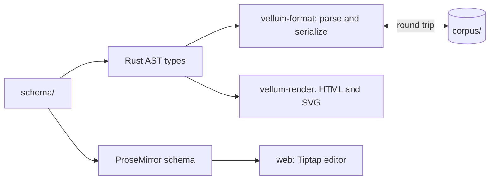

# The block model

`schema/` holds the single definition of every block: its name, its
attributes, its children and how it maps to Markdown. Code generation
produces the Rust types used by `vellum-format` and the ProseMirror
schema used by the editor, so the server and the editor can never
disagree about what a block is.

## The pipeline {#pipeline}

1. A directive pre-pass finds front matter, containers and block IDs.
2. comrak parses the CommonMark and GFM.
3. The Vellum pass turns special fences and inline extensions into typed nodes.
4. The renderer turns the tree into HTML through an allow-list sanitiser, and
   fences into SVG.

## Block identity {#block-ids}

The editor adds a block ID, `^blk-` and eight base32 characters, to a
block the first time something points at it: a comment, a task, an
issue back-link or an AI citation. IDs are unique within a page and
survive edits to the block's text.
