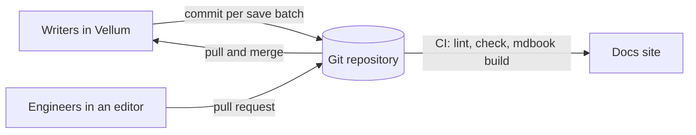

# Docs as code with Git and mdBook

**You will build** product documentation that lives in a Git repository
next to the code, is written in Vellum by people who never touch Git,
reviewed in pull requests by people who do, and published as a website
with mdBook. This guide is built exactly this way.



## Steps

1. Create a shared drive "Product docs" and choose **Git** as its storage. Give
   it the repository URL and a deploy key; Vellum clones it.
2. Create a book "Gateway guide" in the drive. Vellum writes
   `gateway-guide.book/` with `book.yaml` and `SUMMARY.md` into the repository.
3. Write in Vellum. Each batch of saves becomes a commit by the person who made
   it.
4. Engineers edit the same files in their editor and open pull requests. When a
   pull request merges, Vellum pulls and merges the change into the book; a
   clash becomes a conflict copy, never a lost edit.
5. Add CI that runs markdownlint and Vale on the book and builds it with `mdbook
   build`.
6. Publish the site from CI, or from **⋯ → Publish** in Vellum.

## The CI job

```yaml
name: Docs
on:
  push:
    branches: [main]
jobs:
  build:
    runs-on: ubuntu-24.04
    steps:
      - uses: actions/checkout@v4
      - run: npx markdownlint-cli2 "gateway-guide.book/**/*.md"
      - run: vale gateway-guide.book
      - run: mdbook build gateway-guide.book
```

## Why it works

Every page is a Markdown file with its identity in the front matter, so
Git diffs are readable, renames are tracked by ID, and the `SUMMARY.md`
that orders the book is the one mdBook already understands.
