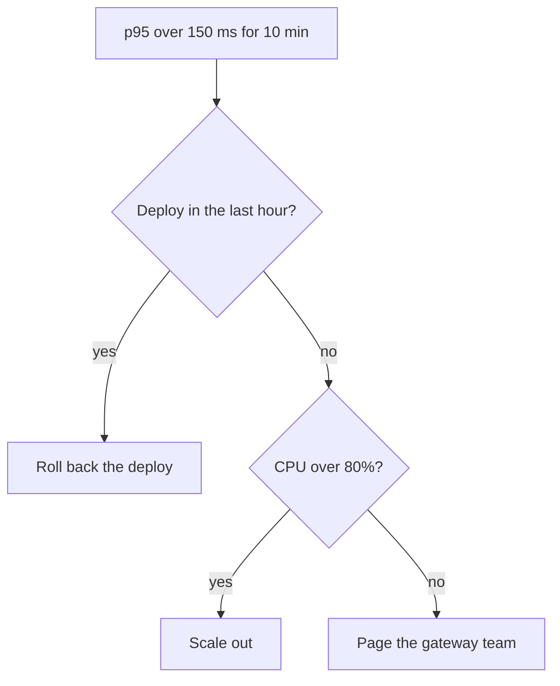

# An on-call runbook with a calculator

**You will build** a runbook that on-call engineers can follow at 3am:
a decision diagram, numbered steps with copyable commands and a
calculator that sizes the rollback.

## Steps

1. Create a page "Runbook: gateway latency" in the OPS shared drive and set its status to verified with `verify_every: 90d`, so it reminds Sam to check it each quarter.
2. Draw the decision with a Mermaid flowchart.
3. Write the procedure with `/steps`, putting each command in a code block.
4. Add a calculator so the engineer can see how many replicas they need.
5. Star the page and add it to the team's on-call shared view.

## The finished page

`````markdown {corpus="page/cookbook-runbook" live=false}
---
id: 01JB9E4F6G8H0J2K4M6N8P0Q2R
title: "Runbook: gateway latency"
icon: 🚨
status: verified
owner: sam
tags: [runbook, on-call]
verify_every: 90d
vellum: 1
---

::: crit
Never roll back the audit writer separately from the gateway.
:::

## Decide



## Size the scale-out

```calculator
rps: Current requests per second = 4000 [500..20000 step 500]
per: Requests per replica = 900 [200..2000 step 50]
result: Replicas needed = round(rps / per + 1) (replicas)
```

## Roll back

::: steps

1. **Find the last good release** with `helm history gateway -n prod`
2. **Roll back** with `helm rollback gateway <revision> -n prod`
3. **Watch** `kubectl rollout status deploy/gateway -n prod`
4. **Announce** in the incidents channel and open an OPS issue

:::
`````
