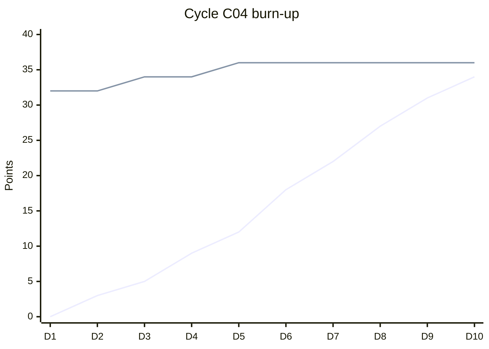

# Running a cycle

**You will** set up two-week cycles for the gateway team, triage the
inbox, plan a cycle and review it at the end.

## Set up

1. Open **Team settings → Cycles** for ENG. Set two weeks, starting Monday, with three cycles created ahead.
2. In **Team settings → Triage**, add a rule: issues with the label `security` get priority urgent and go to Sam.
3. In **Team settings → SLAs**, keep the defaults: urgent 24 hours, high one week.

## Triage

Press `G` then `T`. For each issue, press `1` to accept it, or decline,
mark it a duplicate or snooze it. Aim for an empty inbox before
planning.

## Plan

Open the next cycle with `G` then `C`. Drag issues in from the backlog
until the total estimate matches the team's velocity, shown at the top.

## Review

When the cycle ends, unfinished issues roll into the next one. Open the
finished cycle to see its burn-up chart and paste it into the retro
page:

