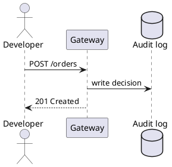

# Architecture and Kroki diagrams

## Architecture

The `architecture` fence draws a system overview from lanes and arrows.
Each `Lane: item, item` line is a row of boxes; each `A -> B` line is an
arrow. Vellum lays it out, so there is nothing to nudge.

```architecture
Clients: Web app, Mobile app, MCP client
Edge: Gateway
Services: API, Render, Worker
Data: Postgres, Object store
Web app -> Gateway
Mobile app -> Gateway
MCP client -> Gateway
Gateway -> API
API -> Render
API -> Postgres
Worker -> Object store
Render -> Object store
```

`````markdown {corpus="fence/architecture"}
```architecture
Clients: Web app, Mobile app, MCP client
Edge: Gateway
Services: API, Render, Worker
Data: Postgres, Object store
Web app -> Gateway
Mobile app -> Gateway
MCP client -> Gateway
Gateway -> API
API -> Render
API -> Postgres
Worker -> Object store
Render -> Object store
```
`````

## Kroki diagrams

The following types are drawn by the Kroki service that runs next to
Vellum. Your admin turns it on in **Admin → Diagrams**; until then these
fences show as code. The [admin guide](../../admin.book/deploy/compose.md)
explains the setup.

### D2

```d2
direction: right
client: Client
gateway: Gateway {
  policy: Policy engine
  audit: Audit writer
}
backend: Backend
client -> gateway.policy: request
gateway.policy -> backend: allowed
gateway.policy -> gateway.audit: decision
```

`````markdown {corpus="fence/d2"}
```d2
direction: right
client: Client
gateway: Gateway {
  policy: Policy engine
  audit: Audit writer
}
backend: Backend
client -> gateway.policy: request
gateway.policy -> backend: allowed
gateway.policy -> gateway.audit: decision
```
`````

### PlantUML



`````markdown {corpus="fence/plantuml"}

`````

### Graphviz

```graphviz
digraph layers {
  rankdir=LR;
  node [shape=box, style=rounded];
  kernel -> contracts -> foundation -> engine -> service -> edge -> app;
}
```

`````markdown {corpus="fence/graphviz"}
```graphviz
digraph layers {
  rankdir=LR;
  node [shape=box, style=rounded];
  kernel -> contracts -> foundation -> engine -> service -> edge -> app;
}
```
`````

### Excalidraw

An `excalidraw` fence holds the JSON that Excalidraw saves. Paste a
drawing exported from Excalidraw, or select **Edit drawing** on the
block to open the editor in place.

```excalidraw
{
  "type": "excalidraw",
  "version": 2,
  "elements": [
    {"id": "a", "type": "rectangle", "x": 0, "y": 0, "width": 160, "height": 60},
    {"id": "b", "type": "text", "x": 40, "y": 20, "text": "Gateway"}
  ],
  "appState": {"viewBackgroundColor": "#ffffff"}
}
```

`````markdown {corpus="fence/excalidraw"}
```excalidraw
{
  "type": "excalidraw",
  "version": 2,
  "elements": [
    {"id": "a", "type": "rectangle", "x": 0, "y": 0, "width": 160, "height": 60},
    {"id": "b", "type": "text", "x": 40, "y": 20, "text": "Gateway"}
  ],
  "appState": {"viewBackgroundColor": "#ffffff"}
}
```
`````

### draw.io

A `drawio` fence holds the XML that draw.io saves (uncompressed).

```drawio
<mxfile>
  <diagram name="Gateway">
    <mxGraphModel>
      <root>
        <mxCell id="0"/>
        <mxCell id="1" parent="0"/>
        <mxCell id="2" value="Gateway" style="rounded=1;" vertex="1" parent="1">
          <mxGeometry x="40" y="40" width="120" height="60" as="geometry"/>
        </mxCell>
      </root>
    </mxGraphModel>
  </diagram>
</mxfile>
```

`````markdown {corpus="fence/drawio"}
```drawio
<mxfile>
  <diagram name="Gateway">
    <mxGraphModel>
      <root>
        <mxCell id="0"/>
        <mxCell id="1" parent="0"/>
        <mxCell id="2" value="Gateway" style="rounded=1;" vertex="1" parent="1">
          <mxGeometry x="40" y="40" width="120" height="60" as="geometry"/>
        </mxCell>
      </root>
    </mxGraphModel>
  </diagram>
</mxfile>
```
`````

The draw.io source is XML inside a code fence, which is data, not HTML:
Vellum never renders it as markup, only as the diagram Kroki draws.
