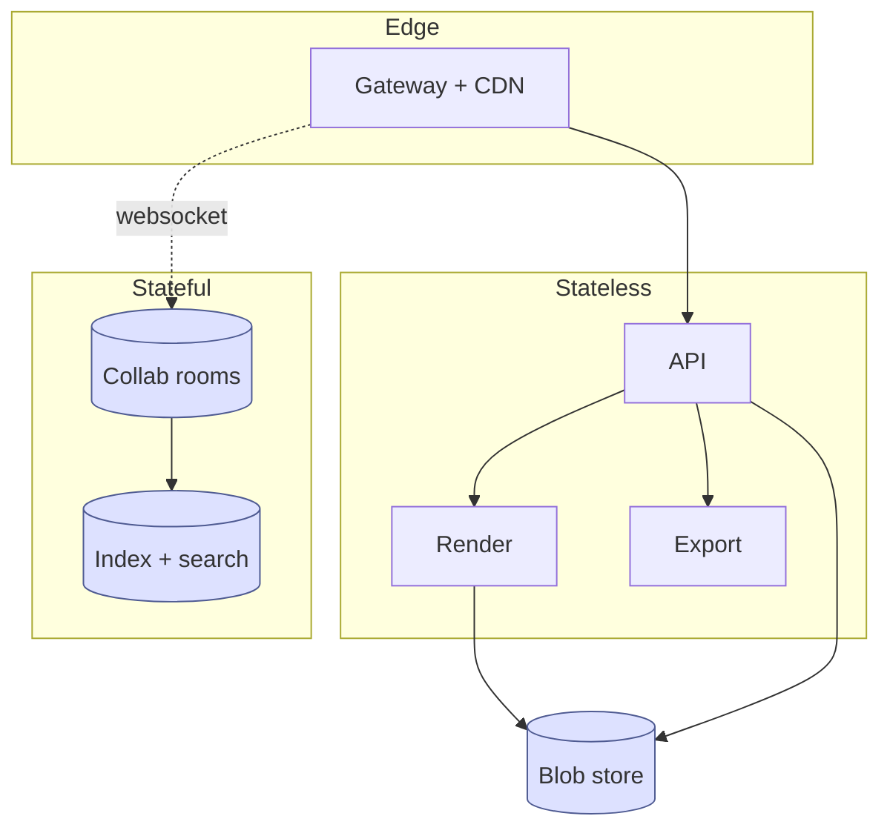
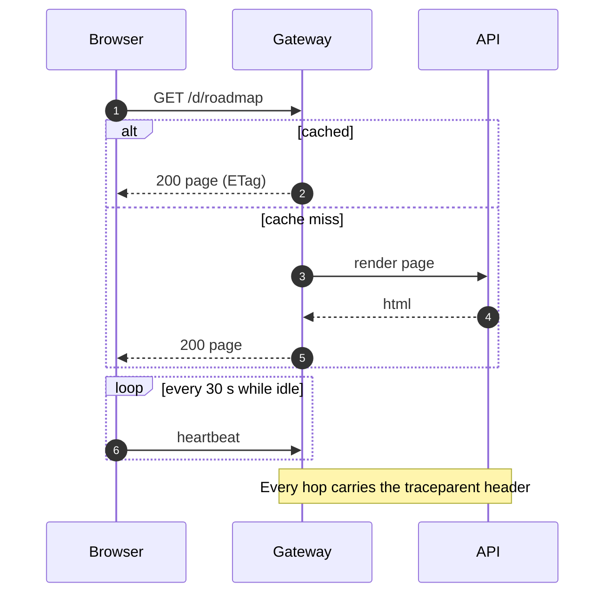
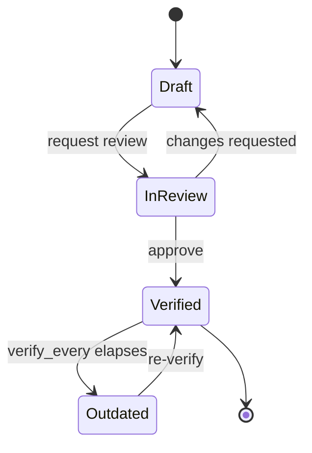
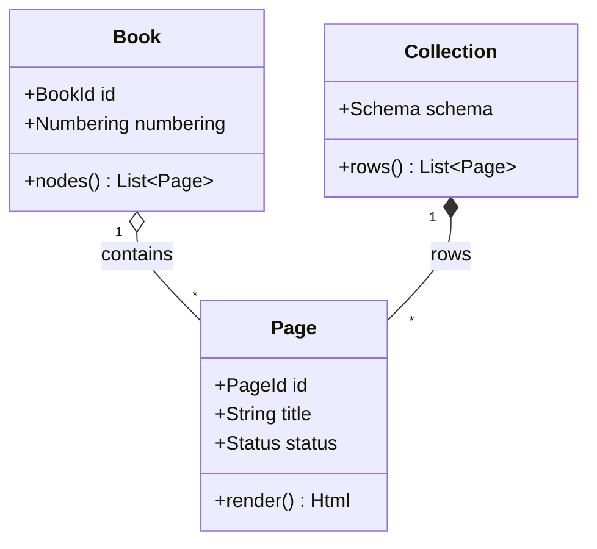
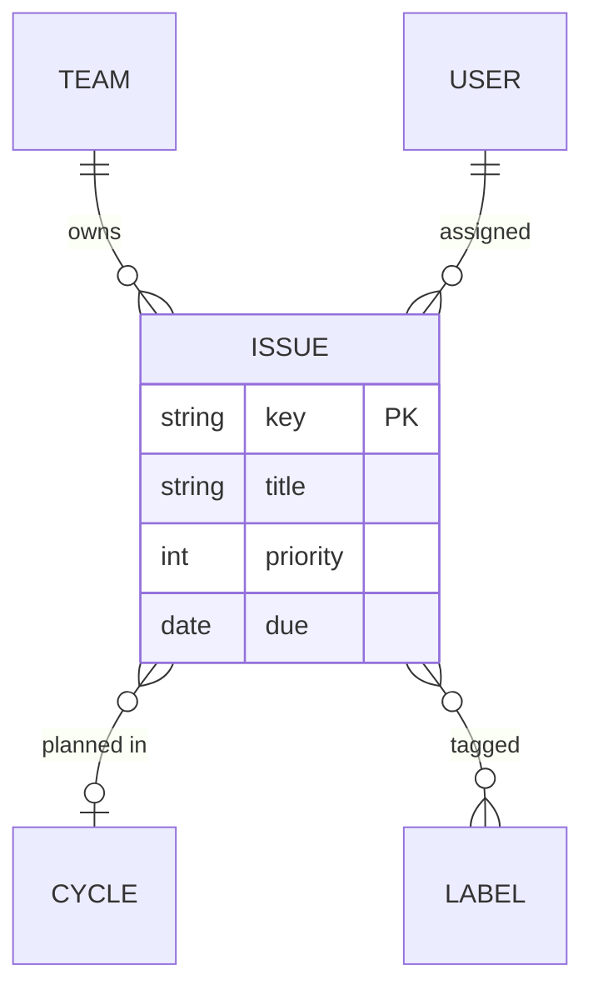
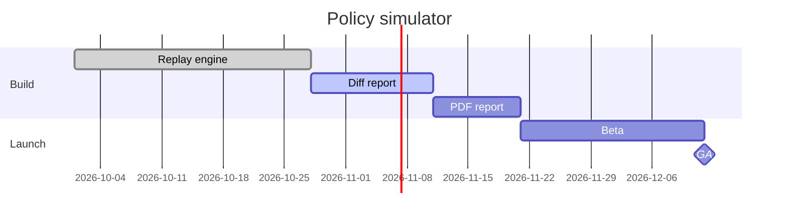
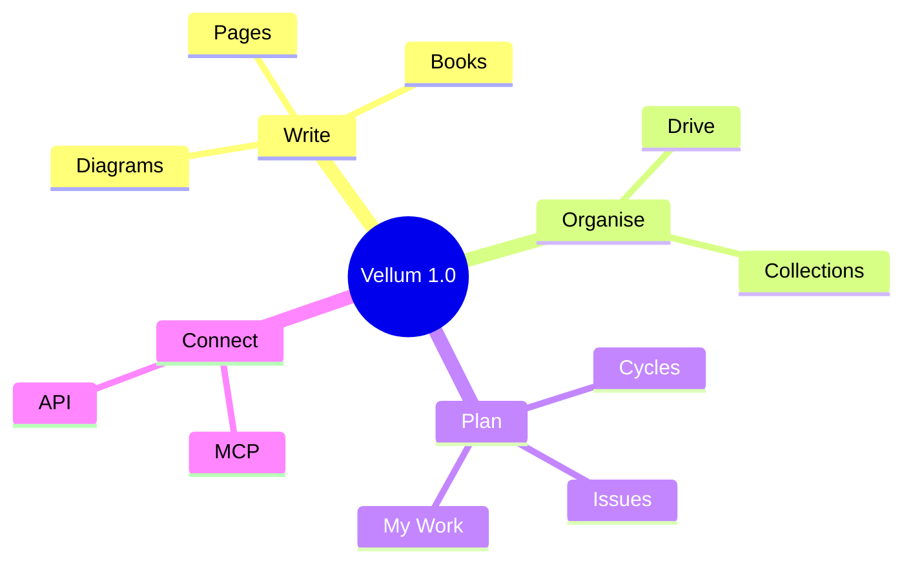
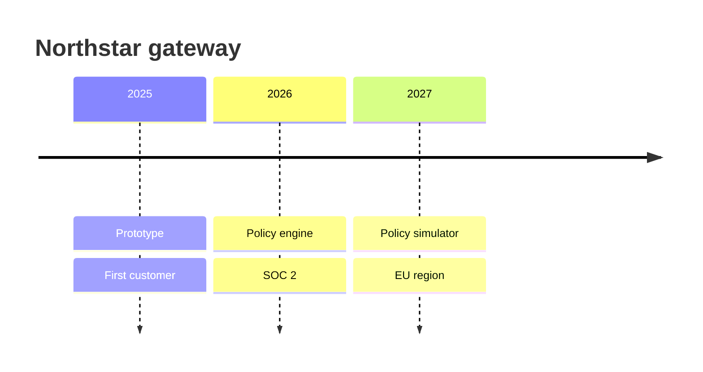
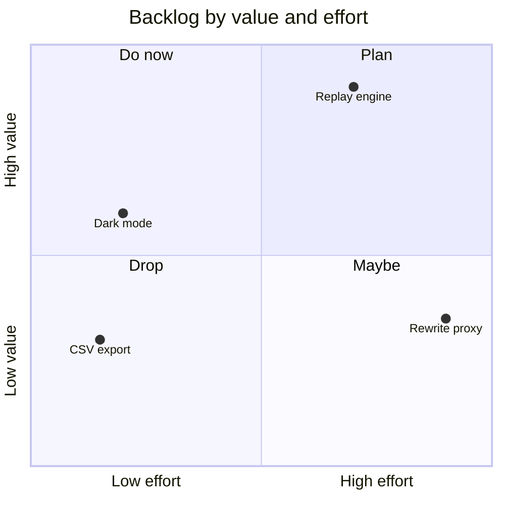
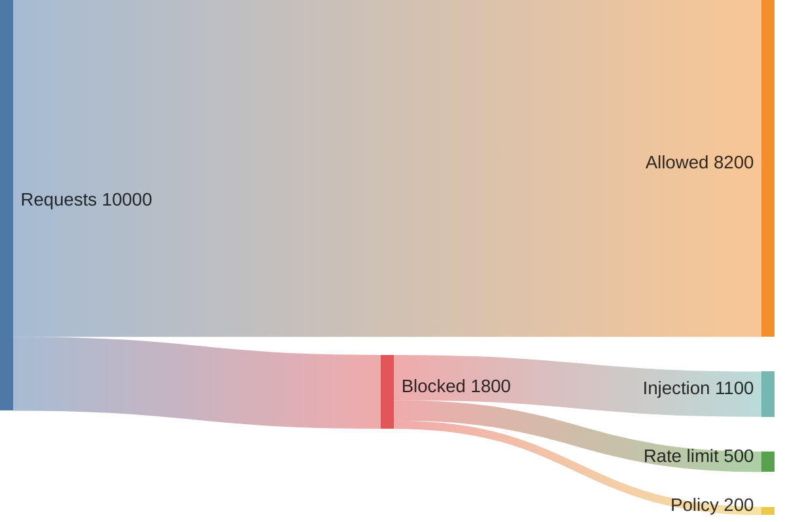

# Mermaid diagrams

Write Mermaid in a `mermaid` fence. Vellum supports every Mermaid
diagram type, renders it on the server, themes it to the page and wraps
long labels. Each type below shows the drawing, then its source. The
[Mermaid documentation](https://mermaid.js.org/intro/) covers every
option.

::: tip
Leave colours out of your diagrams. Vellum's theme colours them to match
the page in light and dark mode; colours you set in `classDef` or
`style` override the theme.
:::

## Flowchart

Boxes and arrows. Direction is `TB`, `LR`, `BT` or `RL`; shapes are `[box]`,
`(rounded)`, `{decision}`, `[(database)]` and more. Subgraphs group nodes, and
`classDef` styles them.



`````markdown {corpus="mermaid/flowchart"}

`````

## Sequence diagram

Messages between participants over time, with `alt`, `loop` and notes.



`````markdown {corpus="mermaid/sequence"}

`````

## State diagram

The states something moves through and the events that move it.



`````markdown {corpus="mermaid/state"}

`````

## Class diagram

Types, their fields and methods, and how they relate.



`````markdown {corpus="mermaid/class"}

`````

## Entity relationship diagram

Tables and their relationships, with crow's-foot cardinality.



`````markdown {corpus="mermaid/er"}

`````

## Gantt chart

Tasks on a calendar with dependencies and milestones. For a simpler roadmap, see
the [roadmap fence](../writing/plans.md#roadmap).



`````markdown {corpus="mermaid/gantt"}

`````

## Mind map

Ideas branching from a centre, by indentation.



`````markdown {corpus="mermaid/mindmap"}

`````

## Timeline

Events grouped by period.



`````markdown {corpus="mermaid/timeline"}

`````

## Quadrant chart

Items placed on two axes, split into four quadrants.



`````markdown {corpus="mermaid/quadrant"}

`````

## Sankey diagram

Flows between stages, as comma-separated `source,target,value` lines.



`````markdown {corpus="mermaid/sankey"}

`````

## XY chart

Bars and lines on shared axes.

```mermaid
xychart-beta
  title "Requests and errors"
  x-axis [Mon, Tue, Wed, Thu, Fri]
  y-axis "Requests (thousands)" 0 --> 120
  bar [80, 95, 102, 88, 110]
  line [4, 6, 5, 3, 2]
```

`````markdown {corpus="mermaid/xychart"}
```mermaid
xychart-beta
  title "Requests and errors"
  x-axis [Mon, Tue, Wed, Thu, Fri]
  y-axis "Requests (thousands)" 0 --> 120
  bar [80, 95, 102, 88, 110]
  line [4, 6, 5, 3, 2]
```
`````

## Git graph

Branches, commits and merges.

```mermaid
gitGraph
  commit id: "skeleton"
  branch develop
  checkout develop
  commit id: "kernel"
  branch feat/format
  checkout feat/format
  commit id: "parser"
  commit id: "corpus"
  checkout develop
  merge feat/format
  checkout main
  merge develop tag: "v1.0.0"
```

`````markdown {corpus="mermaid/gitgraph"}
```mermaid
gitGraph
  commit id: "skeleton"
  branch develop
  checkout develop
  commit id: "kernel"
  branch feat/format
  checkout feat/format
  commit id: "parser"
  commit id: "corpus"
  checkout develop
  merge feat/format
  checkout main
  merge develop tag: "v1.0.0"
```
`````

## Pie chart

Shares of a whole. The [chart fence](../writing/charts.md#pie) draws the same
with more options.

```mermaid
pie showData
  title Time spent this cycle
  "Features" : 55
  "Bugs" : 30
  "Chores" : 15
```

`````markdown {corpus="mermaid/pie"}
```mermaid
pie showData
  title Time spent this cycle
  "Features" : 55
  "Bugs" : 30
  "Chores" : 15
```
`````

## User journey

Steps a person takes and how each one feels, scored 1 to 5.

```mermaid
journey
  title Writing a status update
  section Draft
    Open last week's page: 4: Priya
    Copy the template: 3: Priya
  section Review
    Ask for comments: 4: Priya, Dev
    Resolve comments: 2: Priya
  section Share
    Post the link: 5: Priya
```

`````markdown {corpus="mermaid/journey"}
```mermaid
journey
  title Writing a status update
  section Draft
    Open last week's page: 4: Priya
    Copy the template: 3: Priya
  section Review
    Ask for comments: 4: Priya, Dev
    Resolve comments: 2: Priya
  section Share
    Post the link: 5: Priya
```
`````

## Requirement diagram

Requirements, the things that satisfy them and how they are verified.

```mermaid
requirementDiagram
  requirement replay {
    id: R1
    text: Replay 7 days of traffic in under 10 minutes
    risk: medium
    verifymethod: test
  }
  element replay_engine {
    type: service
  }
  element load_test {
    type: "load test"
  }
  replay_engine - satisfies -> replay
  load_test - verifies -> replay
```

`````markdown {corpus="mermaid/requirement"}
```mermaid
requirementDiagram
  requirement replay {
    id: R1
    text: Replay 7 days of traffic in under 10 minutes
    risk: medium
    verifymethod: test
  }
  element replay_engine {
    type: service
  }
  element load_test {
    type: "load test"
  }
  replay_engine - satisfies -> replay
  load_test - verifies -> replay
```
`````

## C4 diagram

System context, container and component views in the C4 model.

```mermaid
C4Context
  title Northstar gateway: system context
  Person(dev, "API developer", "Calls Northstar APIs")
  System(gw, "Northstar gateway", "Authenticates, rate limits and audits requests")
  System_Ext(idp, "Identity provider", "Issues tokens")
  System_Ext(backend, "Customer backend", "Serves the API")
  Rel(dev, gw, "Calls", "HTTPS")
  Rel(gw, idp, "Validates tokens")
  Rel(gw, backend, "Forwards allowed requests")
```

`````markdown {corpus="mermaid/c4"}
```mermaid
C4Context
  title Northstar gateway: system context
  Person(dev, "API developer", "Calls Northstar APIs")
  System(gw, "Northstar gateway", "Authenticates, rate limits and audits requests")
  System_Ext(idp, "Identity provider", "Issues tokens")
  System_Ext(backend, "Customer backend", "Serves the API")
  Rel(dev, gw, "Calls", "HTTPS")
  Rel(gw, idp, "Validates tokens")
  Rel(gw, backend, "Forwards allowed requests")
```
`````

## Block diagram

Blocks laid out on a grid that you control.

```mermaid
block-beta
  columns 3
  client["Client"] space gateway["Gateway"]
  space space space
  db[("Audit log")] space backend["Backend"]
  client --> gateway
  gateway --> backend
  gateway --> db
```

`````markdown {corpus="mermaid/block"}
```mermaid
block-beta
  columns 3
  client["Client"] space gateway["Gateway"]
  space space space
  db[("Audit log")] space backend["Backend"]
  client --> gateway
  gateway --> backend
  gateway --> db
```
`````

## Packet diagram

The fields of a network packet or binary format, by bit range.

```mermaid
packet-beta
  title Share token record
  0-15: "Version"
  16-31: "Flags"
  32-95: "Expiry (Unix ms)"
  96-127: "Space ID prefix"
```

`````markdown {corpus="mermaid/packet"}
```mermaid
packet-beta
  title Share token record
  0-15: "Version"
  16-31: "Flags"
  32-95: "Expiry (Unix ms)"
  96-127: "Space ID prefix"
```
`````

## Architecture diagram

Cloud services and how they connect, with groups and icons.

```mermaid
architecture-beta
  group cloud(cloud)[Northstar cloud]
  service gw(internet)[Gateway] in cloud
  service api(server)[API] in cloud
  service db(database)[Postgres] in cloud
  service blob(disk)[Blob store] in cloud
  gw:R --> L:api
  api:R --> L:db
  api:B --> T:blob
```

`````markdown {corpus="mermaid/architecture"}
```mermaid
architecture-beta
  group cloud(cloud)[Northstar cloud]
  service gw(internet)[Gateway] in cloud
  service api(server)[API] in cloud
  service db(database)[Postgres] in cloud
  service blob(disk)[Blob store] in cloud
  gw:R --> L:api
  api:R --> L:db
  api:B --> T:blob
```
`````

## Kanban

Columns of cards, for a snapshot of work.

```mermaid
kanban
  todo[To do]
    t1[Write the migration guide]
  doing[Doing]
    t2[Replay engine]@{ assigned: "Dev", priority: "High" }
  done[Done]
    t3[Diff report]
```

`````markdown {corpus="mermaid/kanban"}
```mermaid
kanban
  todo[To do]
    t1[Write the migration guide]
  doing[Doing]
    t2[Replay engine]@{ assigned: "Dev", priority: "High" }
  done[Done]
    t3[Diff report]
```
`````

## Radar chart

Several measures on spokes from a centre, to compare profiles.

```mermaid
radar-beta
  title Gateway options
  axis perf["Performance"], cost["Cost"], ops["Operability"], sec["Security"], fit["Fit"]
  curve a["Build"]{4, 2, 3, 5, 5}
  curve b["Buy"]{3, 4, 4, 4, 3}
  max 5
```

`````markdown {corpus="mermaid/radar"}
```mermaid
radar-beta
  title Gateway options
  axis perf["Performance"], cost["Cost"], ops["Operability"], sec["Security"], fit["Fit"]
  curve a["Build"]{4, 2, 3, 5, 5}
  curve b["Buy"]{3, 4, 4, 4, 3}
  max 5
```
`````

## Treemap

Nested rectangles sized by value.

```mermaid
treemap-beta
"Storage"
  "Pages": 420
  "Assets": 310
  "Index": 90
"Compute"
  "Render": 160
  "Search": 120
```

`````markdown {corpus="mermaid/treemap"}
```mermaid
treemap-beta
"Storage"
  "Pages": 420
  "Assets": 310
  "Index": 90
"Compute"
  "Render": 160
  "Search": 120
```
`````
