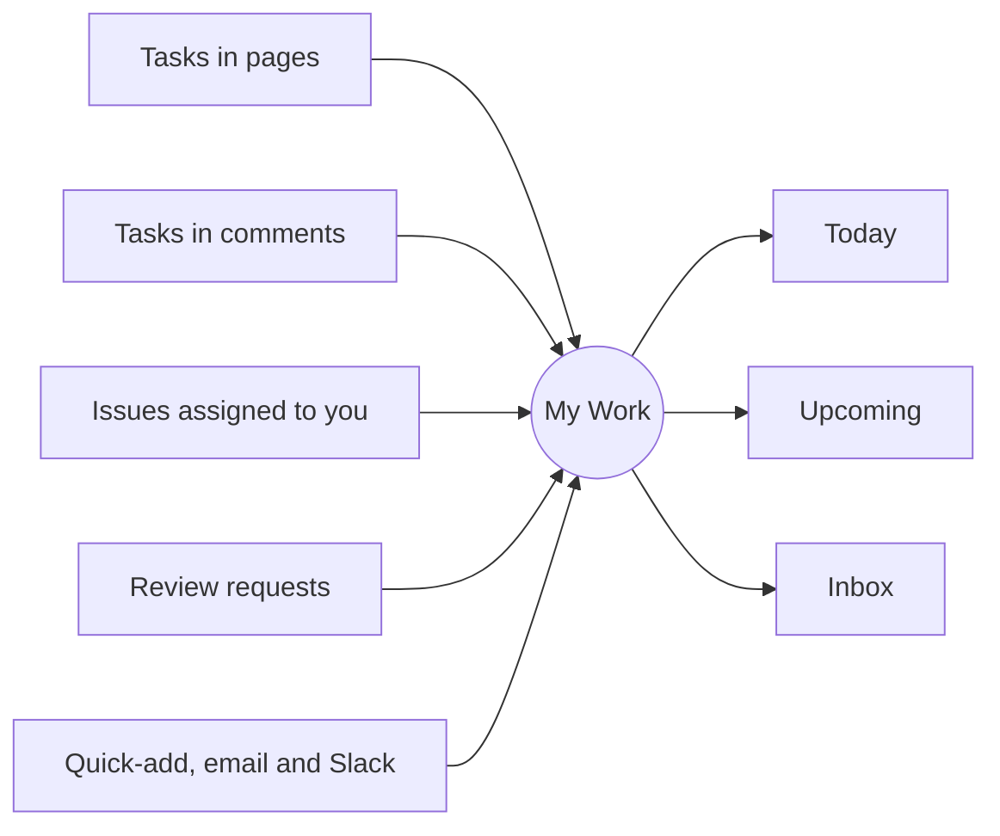

# My Work

**My Work** is one list of everything you have to do, wherever it came
from: your own task lists, tasks assigned to you in pages and comments,
issues assigned to you, review requests and things you captured from
email or Slack.

```image
src: assets/mywork.jpg
alt: My Work showing Today's tasks from pages, issues and review requests in one list
caption: Everything assigned to you, from every page, issue and review, in one list.
```



## Buckets {#buckets}

::: facts

- Inbox: new tasks you have not sorted yet
- Today: due or starting today, with a This evening section
- Upcoming: the next seven days, then week by week
- Anytime: tasks with no date that you could start now
- Someday: ideas you are not committing to
- Done: completed tasks, newest first

:::

To reschedule a task, drag it onto a section, or onto the bar of days and
buckets that shows while you drag. From the keyboard, use the task's
**Move** menu. Moving a task changes its start date; its due date stays.

## Task lists are files {#lists}

A personal task list is a checklist file in your `tasks` folder. You can
edit it in Vellum or in any text editor.

````markdown {corpus="page/task-list" live=false}
- [ ] Call the vendor @today
- [ ] Draft Q1 plan start:2026-11-03 due:2026-11-10 15:00
- [ ] Standup notes every:weekday 09:00
- [ ] Review backups every!:2w
- [ ] Pay invoice p1 #finance remind:2026-11-01 08:00
  - [ ] Get the PDF
````

The Markdown is the source of truth. The task you see in My Work is a
view of that line: ticking it in My Work ticks the line in the file, and
the other way round.

## Tasks in pages {#assignments}

A task in any page that mentions a person and a date is assigned to
that person and shows in their My Work:

- [ ] Send the launch checklist to legal @priya 2026-11-12

````markdown {corpus="block/task-assigned-page"}
- [ ] Send the launch checklist to legal @priya 2026-11-12
````

Select text and press `⌘⌥↵` (or the task button in the toolbar) to turn it into
a task. On a page you can only read, press `T`. Issues assigned to you appear in
My Work too, without being copied.

## Your day and time zone {#settings}

The **Time zone and reminders** section at the foot of My Work holds
three settings, all yours alone:

- **Time zone**: what "today", reminders and the digest follow. The form
  suggests your browser's zone; leave it empty to use the server's.
- **Day starts at**: when Today rolls over. A reminder on a date without
  a time counts from here.
- **Morning digest**: when the daily digest arrives; clear it to stop
  the digest.

Travelling? Change the zone and every relative reminder moves with you.

## Mentions you haven't answered {#mentions}

When someone mentions you in a comment on an issue or a page, the thread
lands in your **Inbox** bucket with who mentioned you. It leaves when you
reply, when the thread is resolved, or when you dismiss it. A thread
assigned to you shows once, as an assignment.

## Fields {#fields}

A task has a separate **start date** (when it shows in Today) and **due
date**, each with an optional time; a priority from `p1` to `p4`; tags;
subtasks; reminders; and a recurrence.

## Shared lists {#shared}

Open **Lists** under My Work to make a list or share one: type a
person's handle and press **Share**. Everyone with access sees the same
list, and tasks can be assigned to any member.

On an issue, fill in **Assign to** when you comment to give that person
the comment as a task in their My Work.
