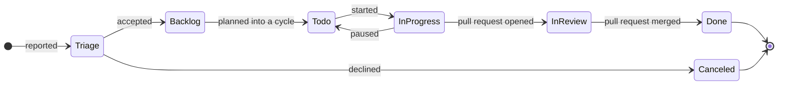

# Issues and teams

**Work** is Vellum's issue tracker: teams, issues, cycles, triage,
projects and Git automation, fast enough to drive from the keyboard.
Every issue is a Markdown file, so specifications, checklists and
diagrams live in the issue itself.

```image
src: assets/board.jpg
alt: The ENG team's board in Vellum, with issue cards in Backlog, Todo, In progress and Done columns
caption: The gateway team's board. Drag a card to change its status, or press S on a selected card.
```

An issue moves through its team's workflow. Triage is where new issues
from outside the team wait; everything after it is the team's own.



## Teams {#teams}

A team owns a set of issues, a workflow and a key prefix. Northstar's
gateway team uses the key `ENG`, so its issues are ENG-1, ENG-2 and so
on. When an issue moves to another team it gets a new key; the old key
keeps working as an alias.

## Create an issue {#create}

Press `C` anywhere. Type a title, then set fields with single keys
(`S` status, `P` priority, `A` assignee, `L` labels, `E` estimate) and
press `⌘↵` to create it. `Alt C` starts from one of the team's
templates.

To turn text in a page into an issue, select it and choose **Create
issue**. The page keeps a live chip; the issue links back to that exact
block.

## An issue is a file

````markdown {corpus="page/issue" live=false}
---
id: 01JB7B2D4F6H8K0M3P5R7T9V1X
team: ENG
number: 142
title: Replay 7 days in under 10 minutes
state: in-review
priority: 1
estimate: 5
assignee: dev
labels: [gateway]
project: 01JB7C3E5G7J9L1N4Q6S8U0W2Y
cycle: 2027-C04
relations: [{blocked_by: 01JB7D4F6H8K0M2P5R7T9V1X3Z}]
due: 2027-01-10
vellum: 1
---

The replay engine reads seven days of traffic from the audit log.

- [ ] Stream from the audit log
- [ ] Parallelise by tenant
````

## Statuses {#statuses}

Each team names its own statuses, but every status belongs to one of
seven fixed categories, which drive the automation and the reports:

| Category | Meaning | Example statuses |
| --- | --- | --- |
| triage | New, not yet accepted | Triage |
| backlog | Accepted, not planned | Backlog, Icebox |
| unstarted | Planned, not started | To do |
| started | In progress | In progress, In review |
| completed | Done | Done, Released |
| canceled | Will not do | Canceled |
| duplicate | Same as another issue | Duplicate |

## Priority and estimates {#priority}

Priority is 0 none, 1 urgent, 2 high, 3 normal or 4 low. Each team picks
an estimate scale: linear (1, 2, 3, 4, 5), Fibonacci (1, 2, 3, 5, 8) or
T-shirt (XS to XL).

## Relations {#relations}

An issue can block, be blocked by, relate to or duplicate another. A
sub-issue names its parent. Blocked issues show a red marker until the
blocker is completed.

## Views {#views}

List or board, grouped by status, assignee, priority, project, cycle or
label, filtered with any mix of `and` and `or` conditions. Save a
view for yourself or share it with the team.

**My Issues** collects everything assigned to you, created by you or
subscribed to, in focus order: urgent first, then breaching SLAs,
blocked, this cycle, in progress, triage, backlog and done.

::: tip
Press `Space` on an issue to peek at it without leaving the list.
:::
