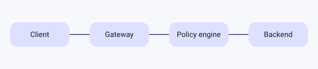

# Images, links and embeds

## Images

Drop or paste an image into a page. Vellum stores it in an `assets/`
folder next to the page and writes a standard Markdown image. The text
in brackets is the alt text that screen readers announce; the editor
asks for it when you add an image.

{width=60%}

````markdown {corpus="block/image"}
{width=60%}
````

Attributes set `width`, `align` (left, center or right) and `lightbox`
(open full size on select).

An `image` fence adds a caption and a dark-theme variant:

```image
src: assets/request-path.svg
dark: assets/request-path-dark.svg
alt: Northstar gateway request path
caption: Every request passes the policy engine before the backend.
width: 80%
```

`````markdown {corpus="fence/image"}
```image
src: assets/request-path.svg
dark: assets/request-path-dark.svg
alt: Northstar gateway request path
caption: Every request passes the policy engine before the backend.
width: 80%
```
`````

## Link cards

A `link` container shows a link as a card with a title and summary.
Links to other Vellum pages show the page's icon and status.

::: link https://vellum.northstar.dev/d/prd-policy-simulator
PRD: Policy simulator
:::

````markdown {corpus="container/link"}
::: link https://vellum.northstar.dev/d/prd-policy-simulator
PRD: Policy simulator
:::
````

## Embeds

An `embed` container shows a video, design or map from YouTube, Figma,
Loom, Google Maps, CodePen or a GitHub gist. Embeds run in a sandbox:
no script inside one can reach the page, your session or your files.
Your admin can turn off any provider.

::: embed https://www.youtube.com/watch?v=aqz-KE-bpKQ
:::

````markdown {corpus="container/embed"}
::: embed https://www.youtube.com/watch?v=aqz-KE-bpKQ
:::
````

## Page grids

A `pages` container shows pages as a grid of cards. With a list of
wikilinks it shows those pages; empty, it shows the current page's
subpages.

::: pages

- [[Runbook: deploy]]
- [[Onboarding checklist]]

:::

````markdown {corpus="container/pages"}
::: pages

- [[Runbook: deploy]]
- [[Onboarding checklist]]

:::
````
